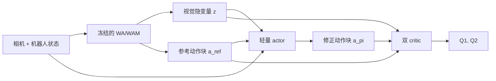
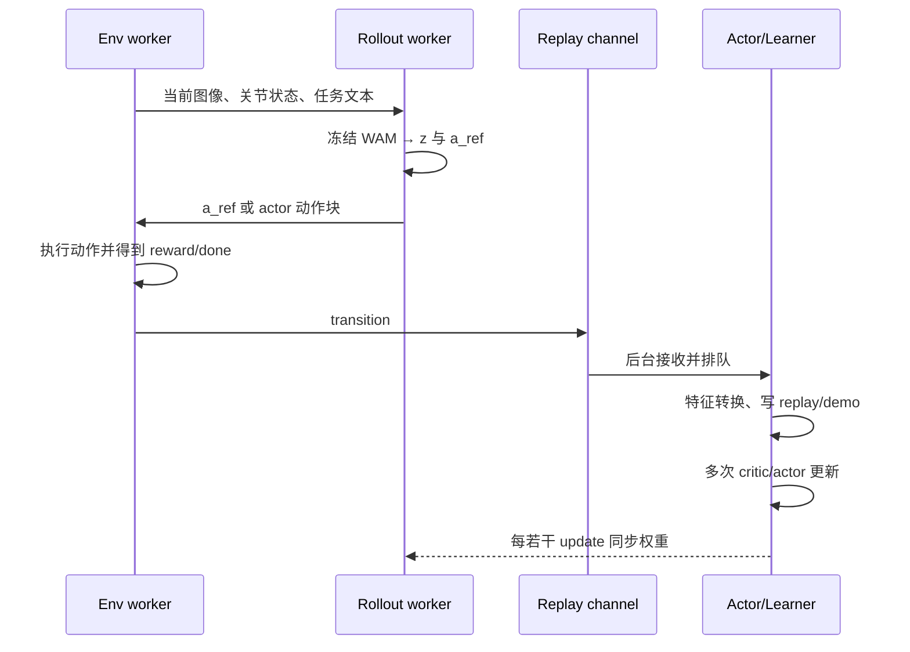

# HALO-WA 全流程解析与迁移到 AHA-WAM / SO101 的实施指南

> 面向没有强化学习前置知识的读者。本文同时回答三个问题：HALO-WA 到底怎样运行；公开论文与当前代码实际实现了什么；它怎样才能安全、合理地迁移到本项目的 AHA-WAM 与 SO101 双相机系统。
>
> 审计日期：2026-08-23  
> 本地 HALO-WA 提交：`611008193fd3438bf99cc8f8377858fbdfcb9555`  
> 本地目录：`/home/fenghao/workspace/HALO-WA`  
> AHA-WAM 目录：`/home/fenghao/workspace/AHA-WAM`

---

## 0. 先给结论

### 0.1 能不能迁移？

**能迁移方法，不能直接搬代码。**

HALO-WA 最有价值的部分不是它依赖的 GigaWA，也不是整套 RLinf 调度代码，而是下面这个思想：

1. 冻结已经训练好的大规模 WA/WAM 主干；
2. 从主干取出视觉隐变量和原始动作块；
3. 训练一个很小的 actor，对原始动作块做任务级修正；
4. 训练两个 critic，估计候选动作块最终能否成功；
5. 一边真实执行、一边收集新数据，通过 replay buffer 持续更新小模型；
6. 用行为克隆损失限制 actor 不要远离原 WAM，避免真实机械臂上的危险探索。

这个思路非常适合“基础 AHA-WAM 已经会大致完成任务，但最后对位、接触、插入或抓取不够准”的场景。它不适合基础策略完全不会做任务的情况。

### 0.2 哪些可以复用，哪些必须重写？

| 层次 | 是否复用 | 说明 |
|---|---:|---|
| 冻结 WAM + 小 actor/双 critic | 是 | HALO-WA 的核心方法 |
| TD3 风格目标、target network、replay/demo 混采 | 是，但要重新定参 | 不能照抄折扣率与 BC 系数 |
| 动作块级 transition | 是 | AHA-WAM 当前 8 步动作块天然适配 |
| HG-DAgger 数据作为 demo 数据 | 是 | 但必须记录完整 transition，而不只是专家动作 |
| RLinf 的 Ray/Hydra/channel 调度 | 后期可选 | 它是基础设施，不是算法成立的必要条件 |
| `GigaWorldPolicy` | 否 | 特征接口、推理 API、相机与动作维度都不同 |
| GigaWA 的 norm 文件与 checkpoint | 否 | 绝不能用于 SO101 |
| RoboTwin 环境 worker | 否 | 需要 SO101 实机环境、控制权切换与安全层 |
| 公开 hammer/bell YAML | 只能参考 | 其中存在论文/代码差异和高风险参数 |

### 0.3 对你当前项目的推荐顺序

```text
稳定的 AHA-WAM 基线
        ↓
数据记录 + 人类接管 + HG-DAgger
        ↓
冻结 AHA-WAM，离线训练小 actor（纯 BC）
        ↓
用成功/失败 transition 验证双 critic
        ↓
回放或仿真中的 TD3+BC
        ↓
实机 shadow mode（只预测，不控制）
        ↓
有限动作偏移、无随机探索的实机在线更新
        ↓
确认正确后，再做 RLinf 异步化
```

**不建议第一步就把 AHA-WAM 塞进 HALO-WA 的 Giga worker，也不建议在真实 SO101 上直接启用随机 actor。**

---

## 1. 最少的强化学习基础

### 1.1 行为克隆、DAgger、RL 分别在解决什么

#### 行为克隆（Behavior Cloning，BC）

把专家数据看成监督学习：给定相机图像和关节状态，预测专家动作。

它的问题是训练时只看过“专家到达的状态”。部署后策略只要有一点误差，就可能走到数据中从未出现过的状态；新的错误又带来更偏的状态，误差不断累积。这叫 **分布偏移** 或 **复合误差**。

#### DAgger

DAgger 的核心是：让当前策略自己运行，让专家对“当前策略实际到达的状态”给出正确动作，然后把这些新样本并回训练集再训练。这样策略逐渐学会从自己造成的偏差中恢复。

#### HG-DAgger

HG 是 Human-Gated。机械臂先由策略控制，人全程监督；看到危险或明显错误时，人接管并保持控制，直到回到安全/有效区域后释放。接管段形成高价值纠正数据。

严格来说，原始 HG-DAgger 还学习基于模型不确定性的风险阈值。工程上常说的“HG-DAgger”往往只实现人类门控接管、聚合数据与重新训练；本文会明确区分这两者。

#### 强化学习（RL）

RL 不要求专家为每个状态给出唯一正确动作，而是用奖励告诉策略“结果好不好”。它适合专家动作不是唯一答案、需要通过交互发现精细修正的情况。

因此：

- HG-DAgger 是交互式模仿学习，不等同于 RL；
- HG-DAgger 擅长教“应该怎样纠错”；
- RL 擅长根据最终成功率优化动作；
- 二者可以顺序组合，而不是互相替代。

### 1.2 MDP 中每个词对应机械臂什么

一个 transition 可以写成：

$$
(s_t, a_t, r_t, s_{t+1}, d_t)
$$

- `state s_t`：当前相机、关节状态、任务文本，以及策略内部记忆；
- `action a_t`：实际发给机械臂的一段动作；
- `reward r_t`：这段动作得到的结果分数；
- `next state s_{t+1}`：动作执行后的观察；
- `done d_t`：任务是否真正终止。

在 HALO-WA 和建议的 AHA-WAM 方案里，一个 `action` 不是一帧，而是一个动作块。你当前 SO101 配置的块长是 8，因此一次 RL 决策会执行最多 8 个 6 维动作。

### 1.3 actor、critic 和 Q 值

- **actor**：根据状态生成动作，记为 $a=\pi(s)\)；
- **critic**：评价状态与动作组合的长期价值，记为 $Q(s,a)\)；
- **双 critic**：同时训练 $Q_1,Q_2\)，取较小者，减轻过度乐观；
- **target network**：actor/critic 的慢速副本，用于构造稳定的训练目标；
- **replay buffer**：保存过去 transition，随机抽样反复训练；
- **off-policy**：数据可以来自旧策略、原始 WAM、人类或当前 actor，不要求只来自最新 actor。

HALO-WA 属于 **TD3 风格的 off-policy actor-critic + 行为克隆正则**，不是 PPO。

---

## 2. HALO-WA 到底是什么

HALO-WA 的出发点是：WA 模型已经能产生具有语义与长时序结构的动作，但实机误差通常发生在最后几毫米。重新训练整个大型生成模型代价高、在线训练也不稳定，所以只在它外面增加一个轻量适配器。



这里有两个容易误解的地方：

1. actor 输出的是一个新的、受边界限制的完整动作块，不是代码层面硬编码的残差 `a_ref + delta`；
2. 大 WAM 冻结，但视觉压缩层、actor 和 critic 会训练。

公开仓库主要是 HALO-WA 对 **GigaWA + RoboTwin** 的补充复现实验。论文中的真实双臂实验流程并没有作为一套可直接运行的实机代码公开。

---

## 3. 本地 HALO-WA 仓库地图

顶层仓库很薄，核心实际上嵌入在 `rlinf/` 中：

```text
HALO-WA/
├── README.md
├── scripts/
│   ├── setup_env.sh
│   ├── run_hammer.sh
│   └── run_bell.sh
├── data/                         # 说明与样例，不是完整资产
└── rlinf/
    ├── examples/embodiment/
    │   ├── train_embodied_agent_gigawa.py
    │   └── config/
    │       ├── online_rl_hammer_ansyc.yaml
    │       ├── online_rl_bell_ansyc.yaml
    │       └── model/giga_world_policy.yaml
    └── rlinf/
        ├── models/embodiment/
        │   ├── giga_world_policy/giga_world_policy.py
        │   └── adapter/gigawa_actor_critic.py
        ├── workers/actor/
        │   └── async_fsdp_gigawa_policy_worker.py
        └── algorithms/gigawa_losses.py
```

文件名中的 `ansyc` 是仓库中的拼写，不是一个新的算法概念；启动时必须按实际文件名使用。

### 3.1 资产并不在 Git 仓库中

`setup_env.sh` 期待外部路径中已经存在：

- RoboTwin 支持代码；
- GigaWA transformer/checkpoint；
- Wan2.2 Diffusers 基座；
- 动作归一化统计；
- hammer/bell 演示 buffer；
- 输出目录。

发布资产约 69 GB，并被拆成许多分片。本机当前 HALO-WA 目录没有这些完整资产，因此可以静态审计代码，但现在不能直接复现实验。本文没有擅自下载这些大文件。

### 3.2 环境

HALO-WA 使用独立的 Python 3.11/RLinf 环境，且依赖 CUDA、`nvcc`、Vulkan、RoboTwin 与 Wan/GigaWA 组件。它与 AHA-WAM 当前 Python/PyTorch 环境不应直接混装。后续即使集成 RLinf，也建议保留两个可复现环境，先通过网络或进程协议解耦。

---

## 4. 从启动脚本到训练循环的完整流程

### 4.1 启动入口

以 hammer 为例：

```text
scripts/run_hammer.sh
  → 激活 HALO 环境
  → source scripts/setup_env.sh
  → 进入 rlinf/examples/embodiment
  → train_embodied_agent_gigawa.py
  → Hydra 加载 online_rl_hammer_ansyc.yaml
  → 创建 Ray workers 和 channel
  → 同时启动 env、rollout、actor 三条长期循环
```

`bell` 流程相同，只换任务配置。

### 4.2 三类 worker

#### Environment worker

负责 RoboTwin：重置环境、取三路相机/机器人状态、执行动作块、收集 reward/done/next observation。

#### Rollout worker

负责策略推理。它拿到当前观察，通过冻结的 GigaWA 产生参考动作和视觉隐变量，再根据配置决定执行基础 WAM 动作还是 RL actor 动作。

#### Actor worker

这里的 actor worker 不只包含 actor，还负责 learner：接收 transition、处理特征、写 replay/demo buffer、采样 batch、更新 actor/critic、维护 target network、保存 checkpoint，并周期性把新权重同步到 rollout。

### 4.3 异步数据闭环



这是**异步 off-policy**：生成数据的 rollout 参数可能比 learner 稍旧，但 replay 算法允许这样做。channel 有容量上限，learner 太慢时会形成反压，避免无限占用内存。

### 4.4 GPU 放置并不等于“任务需要四张卡”

发布 YAML 中的整数是资源/GPU rank：

- hammer：actor 在 GPU 0，rollout 与 env 在 GPU 1；
- bell：actor 在 GPU 2，rollout 与 env 在 GPU 3。

所以单个发布任务按配置占两张 GPU；同时跑两个任务才占四张。actor 配置是单 GPU `no_shard`，不是把一个模型 FSDP 切到多卡。

---

## 5. 一条 transition 是怎样产生的

对于动作块长度 $C=12$的公开 Giga 实验：

1. 环境给出三路图像、14 维机器人状态和任务文本；
2. GigaWA 生成长度 48 的原始动作序列；
3. 只取前 12 步作为 `ref_action`；
4. actor 生成 12×14 的候选动作；
5. 环境执行这个块，并返回块内 reward、终止标志和下一观察；
6. learner 保存当前特征、实际执行动作、累计 reward、下一特征与终止标志。

注意 replay 中必须保存 **实际执行的动作**。如果人类中途接管，不能仍把模型建议动作记成已执行动作，否则 critic 会把结果错误归因给模型。

RoboTwin 的 sparse reward 基本由任务是否成功终止产生。代码会把成功奖励放到动作块内对应的子步，然后在 learner 中把块内 reward 求和。

---

## 6. GigaWorldPolicy 与混合注意力结构

### 6.1 输入

公开配置使用：

- 一路全局相机；
- 两路腕部相机；
- 每路图像约为 256×192；
- 三路横向拼为约 768×192 的画布；
- 14 维双臂状态；
- 12×14 的参考动作块。

缺少的视角可以使用空白图，但这只是兼容做法，不代表空白相机没有信息损失。

### 6.2 冻结主干输出

Giga wrapper 从冻结 WA pipeline 中取：

- WAM 的参考动作 `a_ref`；
- VAE/生成过程的视觉 latent `z`。

视觉 latent 原形类似 `[B, Z, T, H, W]`，随后在时间维做平均或取第一帧、展平成视觉 token，再通过线性层、GELU 和 LayerNorm 压到 512 维。这个压缩器是适配器的一部分，可以训练。

### 6.3 actor

actor 把下列内容变成 512 维 token：

- 一个机器人状态 token；
- 12 个参考动作 token；
- 12 个可学习 action query。

先在这些状态/动作 token 间做 self-attention，学习动作块内部的时间关系；再对视觉 token 做 cross-attention，读取与纠错相关的视觉信息；最后由共享 MLP 为每个 action query 输出 14 维动作。

输出会限制在训练数据的归一化动作范围内，防止任意发散。

### 6.4 critic

critic 接收：

- 1 个状态 token；
- 12 个 WAM 参考动作 token；
- 12 个待评价的候选动作 token。

然后对视觉 token 做 cross-attention，池化后输出一个标量。两个独立 critic 产生 $Q_1,Q_2\)。

一个重要审计结论：论文图文描述 critic 也包含 self-attention，但当前提交的 `CrossAttentionCritic` 实现没有对应的 self-attention block。迁移时应以代码行为为准，并把“critic 是否需要自注意力”做成消融实验，而不是想当然复制论文框图。

---

## 7. HALO-WA 实际优化的损失

### 7.1 critic 目标

代码中的动作块级目标可以概括为：

$$y_t = R_t + (1-d_t)\gamma^C
\min_{i\in\{1,2\}}Q_i^{target}(s_{t+1},\pi^{target}(s_{t+1}))
$$

其中：

- $R_t$是块内 reward 的和；
- $C$是动作块长度；
- $d_t$表示真正终止；
- $\gamma^C$是跨过整个动作块后的折扣。

critic loss 是两个均方误差之和：

$$
L_Q=\mathrm{MSE}(Q_1,y)+\mathrm{MSE}(Q_2,y)
$$

### 7.2 actor 目标

当前代码可概括为：

$$
L_\pi = -\mathbb{E}[\min(Q_1,Q_2)]
+\lambda_{BC}\mathrm{MSE}(\pi(s),a_{ref})
$$

第一项让动作得到更高 Q；第二项让动作不要离 WAM 参考过远。公开配置的 `BC coefficient=50`，但这个数字严重依赖动作是否归一化、Q 的尺度与 MSE 的维度，不能原样搬到 SO101。

论文公式用 $Q_1$优化 actor，而当前代码使用 `min(Q1,Q2)`；这也是版本差异。

### 7.3 为什么叫 TD3 风格，而不是教科书 TD3

它有 TD3 的双 Q、target actor/critic、延迟 actor 更新和软更新；但发布配置把 target policy noise 设为 0。因此更准确的称呼是 **TD3-style + BC**，而不是完整照搬的 textbook TD3。

### 7.4 target network

每次更新后做软更新：

$$
\theta_{target}\leftarrow \tau\theta +(1-\tau)\theta_{target}
$$

公开配置 $\tau=0.005\)，即 target 只缓慢跟随在线网络，降低自举目标抖动。

---

## 8. replay buffer、demo buffer 与训练阶段

### 8.1 两个 buffer

- `replay buffer`：在线 rollout 得到的所有 transition；
- `demo buffer`：预加载的专家数据，以及在开启相应选项时提取的人类干预数据。

发布配置常按 1:1 混采。例如总 batch 64 时，可理解为 replay 32 + demo 32。这样既能吸收新经验，又不至于快速遗忘安全的专家行为。

### 8.2 UTD

UTD（Update-To-Data）表示每获得一定量的新数据，要做多少次梯度更新。公开配置是 5。真实机械臂数据昂贵，较高 UTD 可以提高数据复用率，但过高会对小 buffer 过拟合。

### 8.3 代码支持的阶段

worker 中支持：

1. `bc_actor_pretrain`：先训练 actor 模仿参考动作；
2. `critic_warmup`：固定/弱化 actor，先让 critic 学会基本排序；
3. `full_rl`：联合做 critic 与 actor 更新。

公开的 hammer/bell YAML 直接写 `full_rl`。仓库还有 offline BC、offline critic、offline RL 等入口脚本，但本次审计没有找到它们引用的完整 Hydra 配置，所以这些脚本不是当前公开仓库中开箱即用的流程。

### 8.4 权重同步和 checkpoint

learner 持续更新，rollout 每 20 个 update 左右接收一次权重。checkpoint 会保存 actor 状态，以及 replay/demo buffer 的状态。异步系统恢复时，必须让模型版本与 buffer schema 对上，否则旧特征可能与新模型含义不同。

---

## 9. hammer 与 bell 配置逐项解读

| 项目 | hammer | bell | 含义 |
|---|---:|---:|---|
| 动作块长度 | 12 | 12 | 每次 RL 决策执行的 primitive steps |
| 动作维度 | 14 | 14 | 双臂动作 |
| WAM 原始输出长度 | 48 | 48 | actor 使用其前 12 步 |
| `gamma` | 0.72 | 0.82 | 代码之后还会做 `gamma ** 12` |
| UTD | 5 | 5 | 数据复用率 |
| critic/actor 更新比 | 2 | 2 | actor 更慢更新 |
| BC 系数 | 50 | 50 | 约束 actor 靠近 WAM |
| target noise | 0 | 0 | 没有 TD3 target smoothing |
| replay/demo 混采 | 约 1:1 | 约 1:1 | 离线演示与在线经验并用 |
| warmup | 9999 | 0 | hammer 配置非常可疑 |
| rollout 使用 RL head | 初始否 | 是 | 两任务行为不一致 |

### 9.1 最危险的 `gamma` 误读

配置的 `gamma` 不是最终跨块折扣，代码使用 $\gamma^C\)：

- `0.72^12 ≈ 0.0194`；
- `0.82^12 ≈ 0.092`；
- 论文 hammer 写 `0.92`，则 `0.92^12 ≈ 0.368`。

差异极大。它决定 critic 关注长期结果还是几乎只看眼前 reward。若你希望 AHA-WAM 的 8 步块跨块折扣为 0.95，而代码仍写成 `gamma ** C`，应设置：

$$
\gamma = 0.95^{1/8}\approx 0.9936
$$

不要把 HALO YAML 的 0.72/0.82 复制到 AHA-WAM。

---

## 10. 论文与本地代码的差异审计

这些并不必然意味着代码错误，可能是论文定稿与公开复现版本不同；但它们意味着迁移时不能只看论文。

| 项目 | 论文描述 | 本地提交实际情况 | 迁移建议 |
|---|---|---|---|
| critic 注意力 | self-attention 后 cross-attention | critic 中未见对应 self-attention | 做消融，不盲从框图 |
| actor Q 目标 | 使用 Q1 | 使用 `min(Q1,Q2)` | 先沿用更保守的 min |
| BC 标签 | 可来自 WAM、成功数据、干预数据 | 在线 actor BC 硬连到 `ref_action` | 若要学习人类纠正，显式新增 expert BC loss |
| hammer gamma | 0.92 | YAML 为 0.72 | 先定义清楚“每步/每块”折扣 |
| 仿真 actor 初始化 | 论文称随机 actor、不需 WA warmup | hammer 配置长期先用基础 WAM | 以你自己的 warmup 状态机为准 |
| 实机发布 | 论文有真实双臂实验 | 公开入口只支持 RoboTwin hammer/bell | SO101 控制桥必须自己实现 |
| 离线阶段 | 方法包含预训练思路 | 部分入口缺少公开配置 | 自建可测试配置 |
| PPO/GAE 字段 | 不是核心算法 | YAML 仍遗留 `adv_type: gae`、clip/KL 等字段；专用 worker 的 advantage 计算为空 | 不要据这些字段把算法误判成 PPO |

还有一个与 HG-DAgger 直接相关的问题：当前在线 actor 的 BC loss 对齐 WAM `ref_action`，而不是直接对齐人类实际执行动作。干预动作可以进入 critic 数据，但若想让 actor 明确模仿接管行为，需要增加 `expert_action`/`expert_mask` 对应的监督项。

---

## 11. AHA-WAM 当前推理与 HALO 的接口差异

### 11.1 AHA-WAM 不是普通的单次 VLA

AHA-WAM 是慢速 VideoDiT 世界规划器与快速 ActionDiT 执行器组成的异步层级系统。当前代码的大致过程是：

1. `prefill_video` 根据当前图像建立首帧 VAE latent、VideoDiT 预填充结果和逐层 KV cache；
2. 每次 `infer_action_chunk` 接收最新双相机合成图与 proprio；
3. 最新图像经过 VAE 编码，并由 `chunk_obs_query_encoder` 产生多查询 observation token；
4. OVCR 用新观察编辑/更新视频 KV cache；
5. ActionDiT 通过扩散/流式去噪生成一个动作块；
6. 推理状态继续传给下一次动作块推理。

关键实现位于：

- `src/ahawam/models/wan22/ahawam_chunk_base.py`；
- `src/ahawam/models/wan22/mot.py`；
- `deploy/server/ahawam_policy.py`。

你当前 SO101 流程的重要实际尺寸是：

- 两路摄像机：全局与腕部；
- 6 维状态与动作；
- 控制频率约 15 Hz；
- action horizon 40；
- 每次下发 action chunk 8；
- 两路图像会先合成为模型输入；
- 动作使用当前 SO101 数据统计做归一化/反归一化。

### 11.2 这导致一个关键的 replay 问题

Giga wrapper 更接近“给定当前观察就重新算 latent”。AHA-WAM 的动作却依赖持续变化的内部视频/KV 状态。因此只保存当前图片，训练时再离线重算 latent，可能得不到 rollout 当时使用的同一个状态。

第一版应选择下面一种方案：

1. **推荐：采集时就保存压缩后的 adapter feature、WAM 参考动作与状态版本**；
2. 或保存足够完整的历史帧、KV 更新阶段与随机/去噪条件，保证可重建；
3. 不要只保存一张图，假设它代表完整 Markov state。

还应保存 `planner_age`、当前视频规划阶段、action chunk index、延迟和推理状态版本。这些变量会影响动作，却不一定能从单帧看出来。

---

## 12. AHA-WAM 可以给 RL adapter 哪种视觉特征

候选接口按实现难度排列：

### 方案 A：当前图像的 VAE/观察 token

优点是稳定、易缓存、较容易与 replay 对齐。缺点是可能丢失 VideoDiT 中的长时序规划信息。

### 方案 B：OVCR 的 chunk observation query

它已经是为当前动作块提取的观察表示，比纯 VAE latent 更接近 AHA-WAM 的纠错机制。建议作为第一版的主要候选，但需要加一个明确、冻结、带 shape contract 的特征导出 API。

### 方案 C：更新后的 VideoDiT KV cache

信息最完整，但逐层 KV 很大、与网络结构高度耦合、难以存进 replay，也容易造成显存和通信瓶颈。第一版不建议。

### 方案 D：ActionDiT 中间/最终动作 latent

它非常贴近动作生成语义，但依赖具体去噪时间步和随机性。除非先定义固定抽取点，否则同一观察的 feature 可能漂移。

推荐先做 A/B 对照：

```text
adapter_state = {
    visual_feature: pooled/current OVCR observation tokens,
    proprio: normalized 6D state,
    ref_action: normalized 8×6 WAM action,
    planner_phase: phase/age metadata
}
```

不要把 HALO 的 `_extract_visual_latent_from_ref` 直接搬过来；它绑定 GigaWA/Wan pipeline，与 AHA-WAM 的两阶段推理状态不等价。

---

## 13. 面向 SO101 的建议 actor/critic

### 13.1 第一版 actor

输入：

- 压缩视觉 token；
- 归一化 6D proprio；
- AHA-WAM 的归一化 8×6 参考动作；
- 可选 planner phase/latency token。

输出：归一化 8×6 修正后的**完整动作**。

第一版可以沿用 HALO 的结构：状态与动作 token 做 self-attention，再对视觉 token 做 cross-attention，最后共享 MLP 输出动作。模型只需几百万到几千万参数，不要训练 AHA-WAM 大主干。

### 13.2 绝对动作还是残差动作

HALO 代码输出完整动作。SO101 上还可以考虑显式残差：

$$
a_{out}=a_{ref}+\alpha\tanh(\Delta a)
$$

残差方案天然限制偏移，更适合实机早期；但也可能无法纠正较大误差。建议代码同时支持两种，实机第一阶段用小残差，仿真/离线比较后再决定。

### 13.3 critic

两个 critic 分别接收同一个 `adapter_state` 和候选 8×6 动作，输出动作块级 Q。必须评价的是 **实际下发并执行后的动作**，而不是 actor 原始输出或 WAM 原始输出。

### 13.4 归一化边界

所有训练损失在与 AHA-WAM 一致的模型空间计算。下发前再走现有 SO101 的符号、offset 和物理单位转换。建议同时记录：

- `action_ref_norm`；
- `action_actor_norm`；
- `action_executed_norm`；
- `action_executed_robot_units`；
- `normalizer_version`。

绝不能使用 HALO/GigaWA 的 14 维 norm JSON。

---

## 14. HG-DAgger 怎样接到 HALO 风格 RL

### 14.1 人类接管状态机

```text
POLICY_CONTROL
  ├─ 人按下接管 → HUMAN_CONTROL
  ├─ 安全层触发 → SAFE_STOP
  └─ 任务结束   → EPISODE_END

HUMAN_CONTROL
  ├─ 人释放且状态稳定 → 立即重新观察/重新规划 → POLICY_CONTROL
  ├─ 安全层触发       → SAFE_STOP
  └─ 任务结束         → EPISODE_END
```

接管最好持续到机器人回到明确可恢复的状态，不要在人和策略之间每帧抖动切换。

### 14.2 8 步动作块中途被接管怎么办

这是最容易让 RL 数据失真的地方。假设 WAM 给出 8 步，但第 3 步后人接管：

1. 立即取消剩余 5 步模型命令；
2. 逐步记录前 3 步模型实际动作；
3. 逐步记录后续人类实际动作和 intervention mask；
4. 人释放后，重新获取图像与 proprio；
5. 让 AHA-WAM 重新规划，不要继续执行旧块尾部；
6. transition 的 `action_executed` 必须反映真实混合执行序列。

最简单的第一版是：接管发生时提前截断当前 RL chunk，把它作为 variable-length transition；释放后新开一个 chunk。若 learner 暂时只接受固定 8 步，可以 padding，同时保存 `valid_action_mask`，损失和 reward 都忽略 padding。

### 14.3 HG 数据能否直接作为 demo buffer？

可以，但分两种用途：

- 只有 `(observation, expert_action)`：可用于 BC；
- 有 `(state, actual_action, reward, next_state, done)`：才可可靠用于 critic/TD 学习。

因此，从现在开始就应记录完整 transition。事后只有接管动作但没有下一状态/奖励的数据，无法凭空补成正确 RL transition。

### 14.4 建议的组合 loss

对普通 replay：

$$
L_{actor}^{replay}=-Q+\lambda_{wam}\|a_\pi-a_{ref}\|^2
$$

对接管 demo：

$$
L_{actor}^{demo}=\lambda_{expert}
\|a_\pi-a_{expert}\|^2
+\lambda_{wam}\|a_\pi-a_{ref}\|^2
$$

`expert_mask` 只监督真正由人控制的有效步。这样 HG-DAgger 的纠正信息不会被“永远模仿 WAM”的 loss 抵消。

---

## 15. 实机 replay schema

建议每个动作块保存下列逻辑字段；实际可用 Zarr/Parquet + 图像文件或 episode container，而不是把大数组硬塞 JSON。

```yaml
schema_version: 1
episode_id: string
transition_id: integer
task_id: string
instruction: string

timestamp_observation_ns: integer
timestamp_action_sent_ns: integer
timestamp_action_ack_ns: integer
policy_version: string
backbone_version: string
normalizer_version: string

observation:
  global_image_ref: path-or-index
  wrist_image_ref: path-or-index
  proprio_norm: [6]
  adapter_feature: [num_tokens, hidden]
  planner_phase: integer
  planner_age_ms: float

action:
  ref_action_norm: [8, 6]
  actor_action_norm: [8, 6]
  executed_action_norm: [8, 6]
  executed_action_robot_units: [8, 6]
  valid_action_mask: [8]
  intervention_mask: [8]
  action_source: [8]       # wam / actor / human / safety

outcome:
  reward_per_step: [8]
  reward_sum: float
  terminated: bool
  truncated: bool
  success: bool
  safety_event: string-or-null

next_observation:
  global_image_ref: path-or-index
  wrist_image_ref: path-or-index
  proprio_norm: [6]
  adapter_feature: [num_tokens, hidden]
  planner_phase: integer
  planner_age_ms: float

telemetry:
  inference_latency_ms: float
  round_trip_latency_ms: float
  dropped_frame_count: integer
  stale_observation: bool
```

通道/公网部署时一定要有 sequence ID、时间戳和过期拒绝机制。迟到的动作即使数值正确，也可能对当前机械臂状态完全错误。

---

## 16. reward 应怎样设计

### 16.1 最简单且最干净的版本

- 成功：1；
- 未成功：0；
- 真正任务成功后 `terminated=true`；
- 达到时间上限但没成功：`truncated=true`，不要与成功终止混为一谈。

它最接近 HALO-WA，但样本效率取决于基础 WAM 能否偶尔成功。如果基础成功率几乎为 0，critic 看不到正样本，RL 很难凭空学会任务。

### 16.2 成功检测

优先级建议：

1. 任务可自动验证的传感器/状态；
2. 可靠视觉成功分类器；
3. 人工在 episode 结束时打成功/失败标签。

不要让训练中的 critic 自己充当真实 reward，它会形成自我证明。

### 16.3 可选惩罚

可以加入安全违规、超时、过大动作偏移、强制接管等惩罚，但要谨慎：人类接管表示“需要帮助”，不一定表示接管前后每个动作都是负面。过度惩罚 intervention 可能让策略学会隐藏风险或追求不接管而非完成任务。

---

## 17. 三种迁移工程路线

### 路线 A：AHA-WAM 原生最小闭环（第一阶段推荐）

保留现有 action server/TCP client，在 AHA-WAM 仓库增加：

- 冻结 feature/ref-action 导出接口；
- 小 actor/双 critic；
- 本地 replay/demo buffer；
- 离线 trainer；
- 人类接管与 action arbitration；
- shadow/actor/base 三种部署模式。

优点：依赖少、容易理解、适合单台 SO101、能最快验证算法。缺点：以后要自己补异步调度和容错。

### 路线 B：把 AHA-WAM 正式接入 RLinf（第二阶段）

需要至少完成：

1. 注册 `AHAWAMPolicy`/model type；
2. 实现 RLinf 期望的 policy、rollout 与 weight sync 接口；
3. 新建 SO101 real-world env；
4. 统一 observation/action data class；
5. 重写 Giga 专用 feature conversion；
6. 增加 AHA 专用 worker/loss 配置；
7. 处理两阶段推理状态与 replay 的一致性；
8. 添加 CPU 单元测试、dataset replay 测试与硬件跳过测试。

优点：长期可获得 Ray 调度、channel、checkpoint/replay 恢复和多机扩展。缺点：第一版改动很大，调试时难区分是算法问题还是基础设施问题。

### 路线 C：直接复制 `async_fsdp_gigawa_policy_worker.py`

不推荐。它绑定 Giga 模型名、Giga feature extraction、14 维动作、RoboTwin 数据语义和当前配置遗留项。表面改几个 shape 可能能启动，但最危险的是它会悄悄训练“含义错误的 transition”。

---

## 18. 具体实施里程碑与验收门

### M0：锁定基线与日志

目标：不改变控制策略，稳定记录现有 AHA-WAM episode。

验收：

- 记录双相机、proprio、参考动作、实际动作、时间戳与结束标签；
- 能从日志逐步回放并确认动作单位完全一致；
- 统计纯 AHA-WAM 自主成功率、延迟、失败类型；
- 数据断流或动作过期时安全停机。

### M1：HG-DAgger，不做 RL

目标：完成稳定接管、释放、重规划和数据聚合。

验收：

- 接管不会继续执行旧 action chunk；
- 每一步动作来源可追踪；
- 新一轮 BC 后，独立评测集成功率提高或 intervention rate 降低；
- 没有新增安全事件。

### M2：冻结主干的 adapter BC

目标：只训练小 actor 模仿 WAM/专家，不训练 critic。

验收：

- actor 关闭时与当前部署逐数值一致；
- actor 输出始终满足模型空间和物理空间边界；
- held-out demo 上 expert action error 下降；
- shadow mode 的动作偏移分布可解释。

### M3：离线 critic

目标：用已记录的成功/失败 transition 训练双 critic。

验收：

- held-out 数据中成功动作的 Q 统计上高于失败动作；
- Q 不随训练无界增大；
- 两个 critic 的分歧可以监控；
- 打乱 reward 后性能应明显退化，这是数据泄漏检查。

### M4：仿真/回放中的 TD3+BC

目标：先验证 loss、target、buffer 和 discount 语义。

验收：基础 WAM、BC adapter、RL adapter 三者有固定协议对照；至少多个随机种子，不只看训练 Q。

### M5：实机 shadow mode

actor 只输出建议，不获得控制权。记录若实际采用 actor 会造成多大动作变化、是否越界、Q 是否与真实结局相关。

### M6：有限在线控制

只允许很小残差，关闭随机 exploration noise；episode 数和工作空间有限；每次扩大动作权限都需要通过上一档验收。

### M7：异步化/RLinf

只有前面算法和数据定义已经稳定，才把 rollout、learner、buffer 拆进 RLinf。这样性能优化不会掩盖语义 bug。

---

## 19. 实机安全不是一个 loss

下面的保护必须位于模型外部，即使 actor/critic 全部失效仍有效：

- 独立急停；
- 关节角、速度、加速度和 jerk 限制；
- 工作空间与自碰撞限制；
- 通信 watchdog；
- stale observation/action 拒绝；
- 控制权切换去抖与明确指示；
- 单步/单块最大 WAM 偏移；
- 异常 Q、NaN、超时直接回退 base policy 或停机；
- checkpoint 一键回滚；
- 训练进程不能绕过安全仲裁器直接写电机。

真实机械臂的第一轮在线学习不要通过随机噪声探索。数据多样性先来自不同初始状态、人类接管和受控任务扰动。

---

## 20. 评测指标

至少分开报告：

- `autonomous success rate`：完全无人接管的成功率；
- `assisted success rate`：允许接管后的任务成功率；
- intervention episode rate；
- intervention time/step ratio；
- 每回合接管次数；
- 完成时间；
- actor 相对 WAM 的动作偏移；
- 速度、加速度、jerk 与边界触发次数；
- 推理/网络延迟和过期动作数；
- 双 critic 分歧与 Q calibration；
- 安全事件数。

评测集要固定初始物体位置/场景区间，训练在线采到的 episode 不能直接当独立测试。至少比较：

1. 当前 AHA-WAM；
2. HG-DAgger 后的 AHA-WAM；
3. 纯 BC adapter；
4. TD3+BC adapter；
5. 无视觉 latent 的 adapter；
6. VAE feature 与 OVCR query feature。

这能回答增益到底来自新增数据、模仿学习、RL，还是特征接口。

---

## 21. 针对当前硬件的资源建议

HALO 论文的实机实验使用两张 A800：一张做 learner，一张做 rollout/policy。公开 RoboTwin YAML 也把单任务拆到两张 GPU。

对当前四张 A100 40 GB，可以优先尝试：

- GPU 0：冻结 AHA-WAM 推理；
- GPU 1：小 actor/critic learner；
- GPU 2：离线评测或备用，不必一开始占满；
- GPU 3：可留给数据验证/并行实验。

小 adapter 本身显存需求不大，真正的压力来自 AHA-WAM 主干、两阶段缓存和并发推理。能否在持续 15 Hz 控制同时训练，必须用真实 checkpoint 做 smoke test，不能从 HALO 的 Giga 配置推断。

---

## 22. 最小实现模块建议

后续真正编码时，可以新增而不侵入现有训练主线：

```text
src/ahawam/rl/
├── feature_api.py          # 从冻结 AHA-WAM 导出稳定的 adapter state
├── actor_critic.py         # 小 actor、双 critic、target networks
├── losses.py               # TD3+BC 与 expert BC
├── transition.py           # 严格 schema 与 shape/unit 校验
├── replay_buffer.py        # replay/demo、持久化和采样
├── trainer.py              # staged offline/online learner
└── safety.py               # 仅表达约束接口；硬件安全仍在控制端

scripts/so101_pipeline/rl/
├── collect_hg_dagger.py
├── train_adapter_offline.py
├── evaluate_critic.py
├── run_shadow_adapter.py
└── settings.yaml
```

部署端再增加一个确定性仲裁器：

```text
WAM proposal ─┐
actor proposal ├─→ safety clamp → human gate → stale check → SO101
human action  ─┘
```

每一层必须同时输出“建议动作”和“实际采用动作”，便于 replay 正确归因。

---

## 23. 最容易踩的坑

1. 把 YAML 中残留的 GAE/PPO 字段当成真实算法；实际 Giga worker 走 TD3 风格路径。
2. 把 `gamma` 当跨块折扣，忘记代码还计算 `gamma ** chunk_len`。
3. replay 保存模型建议动作，而不是人类/安全层修改后的实际动作。
4. 用单帧重算 AHA latent，忽略当时的 KV/history/planner phase。
5. 接管后继续执行旧动作块尾部。
6. 把 `terminated` 和时间上限 `truncated` 混为一谈。
7. 直接复制 14 维 Giga normalizer 或 BC coefficient 50。
8. 同时改 backbone、RL、通道和实机控制，导致故障无法定位。
9. 只看训练 Q 上升，不看独立成功率和 Q calibration。
10. 基础策略几乎从不成功，却期待 sparse-reward RL 自己发现任务。
11. 在线更新了 backbone，却仍复用旧的缓存 feature。
12. 让训练代码绕开硬件安全层直接控制电机。

---

## 24. 是否应该先做 HG-DAgger？

对你当前阶段，答案是 **应该**，原因不是 HG-DAgger 比 RL “高级”，而是它能先解决三个基础问题：

1. 建立可靠的人机控制权切换；
2. 收集策略真实失败区域中的纠正数据；
3. 验证动作空间、时间戳、双相机同步和 replay schema。

这些恰好也是安全 RL 的前置条件。HG-DAgger 跑通后，HALO 风格 RL 不是另起炉灶，而是在同一个数据闭环上增加 reward、next state、critic 和 target update。

推荐不要反复全量微调 AHA-WAM 大主干来做每轮 DAgger。可以先比较两条线：

- 少量聚合数据继续微调现有 ActionDiT；
- 冻结主干，只训练 adapter BC。

若小 adapter 已经能吸收纠正数据，后续在线 RL 会更轻、更安全。

---

## 25. 最终推荐的第一版实验

选一个基础 AHA-WAM 已有非零成功率、失败主要发生在精确对位末端的任务。

1. 固定当前 checkpoint 和 normalizer，不更新主干；
2. 收集纯 base 的成功/失败基线；
3. 用 HG-DAgger 收集完整 transition 与 intervention mask；
4. 导出稳定的 pooled OVCR observation feature；
5. 训练小型 8×6 残差 actor，先只做 expert/WAM BC；
6. 训练双 critic，并先验证 held-out 排序；
7. 在离线数据上检查 TD target、Q 范围和 actor 偏移；
8. shadow 部署，确保所有建议动作通过边界；
9. 实机只开放很小残差，无随机噪声；
10. 每达到预设成功率/安全门槛才扩大范围；
11. 整个算法稳定后，再把 learner/rollout 接入 RLinf 异步框架。

这条路径保留 HALO-WA 最有价值的思想，同时避开当前公开代码中与 Giga/RoboTwin 强绑定、实机流程缺失以及配置不一致的问题。

---

## 26. 论文结果说明了什么、没有说明什么

### 26.1 论文报告的结果

论文在四个真实精细操作任务上报告：基础 WA 平均成功率 26.4%，HALO-WA 为 87.1%；每个任务用 35 次独立执行评测，在线训练时间约 45–75 分钟。论文对照中的 HG-DAgger 平均约 62.9%，RL-token 类方法约 67.9%。

在公开对应的 RoboTwin 补充实验中：

- click bell：基础策略约 54%，HALO-WA 约 97%；
- hammer：基础策略约 22%，HALO-WA 约 45%；
- 每项按 100 次执行统计。

这些结果支持一个有限但重要的结论：当基础 WA 已经具有任务能力、失败集中在部署误差和末端精细操作时，冻结主干的小型在线 actor-critic 可以显著提高成功率。

### 26.2 这些结果不能证明什么

- 不能证明它能让一个成功率为零的策略学会全新任务；
- 不能证明公开 RoboTwin 配置已经复现论文真实双臂流程；
- 不能证明 HALO 的超参数可跨机器人、动作单位和块长复用；
- 不能证明任意 WAM latent 都自动适合作为 critic 状态；
- 不能证明在网络通道延迟下仍保持相同稳定性；
- 不能用训练时间直接估算 SO101 所需时间，因为机器人、成功率、采样频率和硬件不同。

论文也明确承认其适用边界：方法主要是对已有基本能力的 WAM 做精细修正，并且当前只利用视觉，没有力觉/触觉。因此若 SO101 任务高度依赖接触力，仅靠两路 RGB 可能仍有不可观测性。

---

## 27. 怎样复现公开 HALO-WA，而不污染 AHA-WAM 环境

本文没有执行下载或训练，原因是用户当前目标是审计与迁移设计，而且本地缺少约 69 GB 发布资产。若以后需要单独复现，应在 HALO-WA 目录按其 README 进行，并保持与 AHA-WAM 环境隔离：

```bash
cd /home/fenghao/workspace/HALO-WA
conda env create -f environment.yml
conda activate halo-wa

cd rlinf
bash requirements/install.sh embodied --model openvla-oft --env wan --install-rlinf --no-root
bash requirements/install.sh embodied --model openpi --env robotwin --install-rlinf --no-root
source .venv/bin/activate
cd ..

bash scripts/download_artifacts.sh
bash scripts/run_hammer.sh
# 或：bash scripts/run_bell.sh
```

在这台服务器上还要按现有运维约定先加载匹配 NVIDIA 驱动/CUDA 的环境；不要假设新 shell 已自动继承。RoboTwin/SAPIEN 还需要 `nvcc` 与 Vulkan。

仓库 README 只声明两个配置在作者开发服务器上完成过 **一个 global step 的 smoke test**。这证明启动链路曾被跑通，不等价于仓库已经提供完整收敛曲线或本机复现保证。真正复现应依次检查：

1. 所有 artifact 的 SHA256；
2. Python、PyTorch、CUDA、Vulkan 和 SAPIEN 版本；
3. Hydra 展开后的最终配置，而不是只读一份 YAML；
4. 三路图像 shape、14 维动作和 norm stats；
5. demo/replay 最小采样；
6. 一步 rollout、一步 critic update、一步 actor update；
7. checkpoint 保存和恢复；
8. 固定 seed 的短回归；
9. 最后才运行长训练。

复现 HALO 与实现 AHA 迁移是两个独立实验。前者可帮助理解基准，但不是后者的硬前置条件。

---

## 28. 资料与代码索引

### 官方资料

- HALO-WA 论文：[arXiv:2607.04265](https://arxiv.org/abs/2607.04265)
- HALO-WA 公开仓库：[YeanRoot/HALO-WA](https://github.com/YeanRoot/HALO-WA)
- HG-DAgger 原论文：[arXiv:1810.02890](https://arxiv.org/abs/1810.02890)
- RLinf 官方仓库：[RLinf/RLinf](https://github.com/RLinf/RLinf)
- RLinf 官方文档：[rlinf.readthedocs.io](https://rlinf.readthedocs.io/en/latest/)
- GigaWA 官方仓库：[open-gigaai/giga-world-policy](https://github.com/open-gigaai/giga-world-policy)

### 本地 HALO-WA 关键代码

- `scripts/run_hammer.sh`、`scripts/run_bell.sh`：启动入口；
- `scripts/setup_env.sh`：外部资产路径；
- `rlinf/examples/embodiment/train_embodied_agent_gigawa.py`：runner 入口；
- `rlinf/examples/embodiment/config/online_rl_hammer_ansyc.yaml`：hammer 配置；
- `rlinf/examples/embodiment/config/online_rl_bell_ansyc.yaml`：bell 配置；
- `rlinf/examples/embodiment/config/model/giga_world_policy.yaml`：模型/优化参数；
- `rlinf/rlinf/models/embodiment/giga_world_policy/giga_world_policy.py`：冻结 WAM 包装与推理；
- `rlinf/rlinf/models/embodiment/adapter/gigawa_actor_critic.py`：actor/critic；
- `rlinf/rlinf/workers/actor/async_fsdp_gigawa_policy_worker.py`：buffer 与训练状态机；
- `rlinf/rlinf/algorithms/gigawa_losses.py`：实际 TD3+BC loss。

### 本地 AHA-WAM 关键代码与配置

- `src/ahawam/models/wan22/ahawam_chunk_base.py`：`prefill_video`、`infer_action_chunk` 与 observation query；
- `src/ahawam/models/wan22/mot.py`：OVCR/KV cache 更新；
- `deploy/server/ahawam_policy.py`：部署推理包装；
- `scripts/so101_pipeline/online_deploy/ahawam_tcp_client.py`：SO101 客户端与动作转换；
- `scripts/so101_pipeline/online_deploy/settings.yaml`：当前部署配置；
- `scripts/so101_pipeline/full_finetune_zero2_offload/`：当前 SO101 训练流程；
- `runs/so101_ahawam_nw_2/assets/dataset_stats.json`：当前 SO101 数据统计，迁移时必须保持版本化。

---

## 29. 一句话总结

HALO-WA 不是“给 AHA-WAM 加一个 PPO 配置”，而是围绕冻结 WAM 建立一个动作块级、双 critic、replay/demo 混采、带 BC 安全约束的在线适配闭环；对当前 SO101，正确顺序是先用 HG-DAgger把控制权、数据和安全闭环做对，再以 AHA-WAM 自身的时序 latent 与 8×6 动作为接口实现小 adapter，最后才考虑把成熟流程迁入 RLinf。
