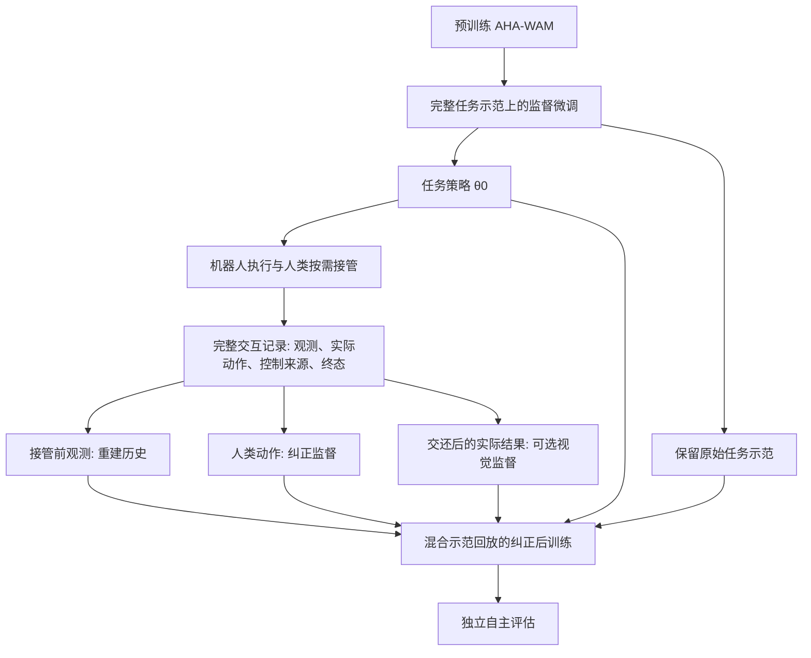

# 人类纠正如何改进世界—动作模型：当前论文参考稿

> 最终贡献与实验矩阵以[三个贡献简版](04_FINAL_CONTRIBUTIONS_ONE_PAGE_ZH.md)和[最终表格与配图](05_FINAL_TABLES_AND_FIGURES_ZH.md)为准。本稿保留背景与方法展开；早期候选实验不代表截止前必做项。

**参考英文题目：Learning from Human Corrections in Memory-Based World–Action Models**

**2026-09-14 定稿范围修订：正文仅保留任务SFT、完整模型纠正训练、未来视觉延伸，以及13场景首次试验结果。**

本稿供论文作者阅读。采用的方法不含新增小型网络；OVCR仅作为AHA-WAM原有接口解释。power v3是唯一待补的第二任务位置。后续新方法与尚未完成的机制对照另见研究设计文档，不属于当前论文的已完成贡献。

## 摘要

预训练机器人策略能够从示范中学习操作技能，但在精细插入等接触任务中，较小的执行偏差仍可能导致失败。人类接管提供了针对这些失败状态的局部纠正，然而，将短接管片段直接作为独立示范用于后训练，并不一定适合带历史记忆和视频预测目标的世界—动作模型：片段截断可能同时移除决策所需的历史上下文、限制未来视频监督，使训练目标在交还控制处中断。本文研究面向此类模型的人类纠正学习协议，分别定义历史观测、动作标签和未来视觉目标的使用范围。我们基于 AHA-WAM 实现同一交互轨迹内的跨接管历史重建，在仅监督人类纠正动作的前提下，比较接管段内与跨交还边界的未来视觉监督。训练结合原始示范回放，以缓解局部纠正对已有技能的影响。在相同13个初始化场景的首次试验中，圆柱任务的原SFT、基本纠正与未来视觉延伸策略分别完成1/13、5/13和6/13次，并观察到抓取与插入偏差后的定向调整。【待补第二任务；提交前核对逐trial记录、测试权重及成功判据。】

## I. 引言

从示范学习为机器人获取操作技能提供了直接途径。给定视觉观测、机器人状态和任务指令，策略通过拟合人类动作学习完成任务。然而，部署时机器人会访问与示范不同的状态。例如，夹持位置的微小变化可能使圆柱偏离孔中心；一次对准误差也可能使后续插入动作持续作用于错误位置。对于这些精细操作，策略需要掌握偏离正常轨迹后的恢复行为，而不仅是重复成功示范中的动作序列。

人类接管能够在机器人遇到困难时提供针对性的监督。机器人先执行当前策略，人类在认为需要纠正时接管，完成局部调整后再将控制权交还。这种交互方式减少了重复演示任务简单部分的需求，也让训练数据覆盖策略实际访问的困难状态。但是，接管通常只持续一小段时间。如何将这些短纠正与原始示范结合，取决于策略使用什么上下文、预测多长的动作，以及训练还包含哪些辅助目标。

本文关注世界—动作模型（World–Action Models, WAMs）。这类模型将视觉时序建模与动作生成结合，使机器人策略能够利用视频模型学习到的场景与运动表征。我们采用的 AHA-WAM 还保留历史视觉上下文，并在预测动作前根据最新观测调整可读取的视频特征。因此，一段纠正片段的起点并不一定是模型状态的自然起点；同样，人类交还控制的时刻也不一定是一个子任务的结束。

以抓取对准为例，一次人类微调可能只有很短的动作序列，但此前的接近过程仍包含当前姿态与物体关系的信息。若将接管前的观测一并删除，模型训练时的历史条件可能不同于部署时实际拥有的历史；如果未来视频也在交还时刻截断，大量纠正起点就无法提供完整的视频目标。与此同时，自主控制产生的观测可以作为上下文，却不能因此自动成为专家动作标签。

基于这一观察，我们将问题表述为：**如何区分一条交互轨迹中“可作为上下文的观测”和“可作为监督的目标”，使短人类纠正能够用于带记忆的 WAM？** 我们保留同一轨迹内接管前的视觉历史，而不将相应自主动作自动当作专家标签；在此基础上，研究是否利用成功交互中交还控制后的视觉结果，同时保持动作标签限定在人类接管内。所有纠正训练均与原始示范混合，以保留正常任务行为。

本文的主要内容可组织为以下三项：

1. 建立从真实机器人接管记录到带记忆 WAM 后训练的数据与训练流程，明确区分观测上下文、动作监督及系统等待。
2. 提出并实现按用途定义时间范围的纠正学习协议，研究接管前历史保留与交还控制后的监督延伸。
3. 在圆柱插入任务中比较任务SFT与两种纠正训练配置，报告完整任务表现及恢复行为，并在电源适配器任务中复现主配方【第二任务结果待补】。

上述表述将 AHA-WAM 作为已有骨干。视频模型、动作模型和原生观测路由接口均不是本文重新提出的网络结构；本文研究的是它们如何利用真实交互中的短人类纠正。

## II. 背景与相关工作

### A. 行为克隆与人类接管学习

行为克隆（Behavior Cloning, BC）通过监督学习，使策略在示范观测下输出接近专家的动作。本文将预训练模型在任务示范上的监督微调称为 SFT（Supervised Fine-Tuning）；在当前连续动作策略中，它采用生成式动作训练目标，属于模仿学习，而非奖励最大化。

DAgger（Dataset Aggregation）的基本思想是执行当前策略，在其访问的状态上获得专家动作标签，再将这些标签加入训练数据。这有助于处理部署状态与原始示范分布之间的差异。实际机器人中常采用人类控制接管的形式：专家只在部分困难状态介入，而非为全部状态重新标注。本文属于这种 **human-gated corrective imitation learning**。当前有效数据包含一次任务 SFT 后收集的纠正批次，不应将其描述为已经验证多轮在线自我改进。

[IWR](https://sites.google.com/stanford.edu/iwr)通过提高接管样本在回归训练中的比例强调操作瓶颈；[SIRIUS](https://ut-austin-rpl.github.io/sirius/)进一步研究基于人类信任的样本加权和部署学习。因此，混合示范与接管数据、按控制来源选择标签已有研究基础。本文需要通过实验支持的区别，是带记忆和视频辅助目标的 WAM 对短接管时间范围的特殊要求，而不是数据聚合本身。

### B. 世界—动作模型与视频上下文

WAM 将视觉世界建模与动作生成联系起来。本文使用的 AHA-WAM 包含 Video DiT 和 Action DiT，其中 DiT 表示 Diffusion Transformer，即用于生成式去噪/流预测的 Transformer 网络。Video DiT 提供视觉时序表征，Action DiT 生成机器人动作序列。视频预测的作用不仅是输出可视化图像，其内部特征也可以为动作决策提供条件。

Transformer 的键和值（Key/Value，简称 K/V）是注意力读取的信息表示。历史视觉观测可被编码为 K/V 缓存，使后续计算利用之前的场景信息，而不必在每次动作更新时重新处理完整历史。这里的“记忆”是模型可读取的视觉上下文，不是强化学习中存储训练样本的经验回放池。

带记忆模型使用截断片段训练时，需要考虑片段起始状态如何重建。[R2D2](https://willdabney.com/publication/r2d2/)在循环强化学习中研究了表征漂移与状态过时问题，说明序列状态构造本身值得关注；但该结论不能直接替代本文对 WAM 历史接口的验证。

### C. 与已有世界模型辅助交互学习的区别

[Sirius-Fleet](https://ut-austin-rpl.github.io/sirius-fleet/)使用视觉世界模型辅助部署异常预测与接管请求，并通过交互数据改进策略。因此，“世界模型结合人类接管”不是足够具体的新颖性主张。本文聚焦生成式世界—动作骨干内部的后训练：短纠正如何保持其历史条件，以及如何利用交还后的视觉目标。本文没有奖励优化或critic，属于监督式纠正学习。

## III. 问题定义与基础模型

### A. 观测、动作与交互轨迹

在机器人控制时刻 $t$，记观测为

$$
o_t=(I_t^{\mathrm{global}},I_t^{\mathrm{wrist}},q_t),
$$

其中两张图像分别来自外部全局相机与腕部相机，$q_t$ 为机器人关节及夹爪状态。任务指令记为 $\ell$。本文平台使用六维状态与动作表示，动作遵循原任务数据中的控制定义，并采用任务 SFT 的统计量归一化。

策略以观测、历史上下文 $h_t$ 和任务指令为条件，生成动作序列：

$$
A_t\sim\pi_\theta(\cdot\mid o_t,h_t,\ell),
\qquad A_t=(a_t,\ldots,a_{t+H-1}).
$$

一次预测可以覆盖较长 horizon，但机器人只执行短前缀，再利用新观测更新动作。这是动作分块与闭环更新的区别：预测未来40步不表示一次开环执行40步。

一条交互轨迹记为

$$
\tau=\{(o_t,a_t,c_t)\}_{t=0}^{T},
\qquad c_t\in\{\text{policy},\text{human},\text{hold}\},
$$

分别表示自主策略控制、人类控制和等待推理等原因导致的系统保持。轨迹另带终态结果 $y_\tau$。实际记录还保留时间戳、控制有效性与丢帧信息。本文用 $\mathcal D_D$ 表示原任务示范，用 $\mathcal D_H$ 表示从有效人类接管段中选择的纠正起点；后者仍指向原始完整轨迹，而不只保存裁剪后的视频。

### B. AHA-WAM 与原生 OVCR

AHA-WAM 将较低频更新的视频上下文与较高频更新的动作生成分开。为了让可复用的视频上下文适应最新观测，原模型使用 **Observation-Guided Video-Context Routing（OVCR，观测引导的视频上下文路由）**。它不是本文新增的 critic，也不是一个独立机器人策略，而是 Video DiT 与 Action DiT 之间的特征读取和更新接口。

具体而言，最新观测被编码为一组查询向量 $Q$。对于某层视频缓存 $(K,V)$，路由先读取观测相关内容，再映射回视频缓存的空间位置。省略多头、batch与层下标，可将其概括为

$$
R=\operatorname{softmax}\!\left(\frac{P(Q)K^\top}{\sqrt d}\right)V,
\qquad
D=\operatorname{softmax}\!\left(\frac{KR^\top}{\sqrt d}\right)R,
$$

$$
(\Delta K,\Delta V)=F(D),\qquad
(\bar K,\bar V)=(K,V)+g(\Delta K,\Delta V).
$$

$P$ 是查询投影，$d$ 是单头维度，$F$ 是原模型的特征映射，$g$ 表示其门控系数。Action DiT 使用更新后的视觉上下文生成动作。这一过程让最新观测影响动作，而不要求每个控制tick都重新计算完整视频分支。

本文部署使用动作服务路径，不应据此声称每次决策都显式生成并评估一段未来视频。视频生成目标用于训练；部署读取内部视频特征与历史上下文。

### C. 短接管带来的训练问题

设一次人类接管覆盖区间 $[s,e]$。将其独立裁剪为示范会产生三个不同问题。

**历史截断。** 对 $t\in[s,e]$，仅从 $[s,t)$ 构造历史可能丢弃此前已知的抓取、移动或接近过程。部署时这些观测仍可能存在于模型缓存中。

**视频目标不足。** 如果未来视频只能取到 $e$，越接近段末尾的起点越难构造完整训练窗口。相比长示范，纠正样本获得视频辅助监督的机会更少。

**标签来源混淆。** 如果为补齐窗口而直接加入交还后的自主动作，训练就不再只拟合人类纠正。本文保留动作有效掩码，单独延伸视觉目标，不将可读取的观测范围等同于可信动作标签范围。

这三个问题分别涉及输入条件、视觉目标和动作目标，不能只用一个统一的“是否保留片段外数据”开关概括。

## IV. 方法：按用途构造纠正训练窗口

### A. 总体流程

首先从通用预训练权重出发，使用完整任务示范训练任务策略 $\theta_0$。随后在真实环境部署该策略，由人类按需接管并记录完整交互。后训练从 $\theta_0$ 初始化，混合原示范与纠正起点，为每个起点分别构造历史、动作目标和视频目标。



以下先定义基本的上下文保留方法，再定义未来视觉延伸。两个纠正版本共享骨干与优化器，可用于检验不同时间信息的作用；本文不预设延伸版本一定更好。

### B. 有效纠正起点与控制来源

只有人类接管标记、动作有效性和帧连续性同时满足要求时，记录才进入纠正动作标签。丢帧或控制来源切换将接管划分成独立连续段。模型仍可读取原始轨迹中的其他观测，但这些位置不会自动获得专家动作标签。

系统保持帧被单独标记，避免把推理等待当成人类纠正。在基本方法中，我们不对自主或保持动作计算纠正动作损失，也不采用按低运动速度删除人类片段的规则，因为精细对准本身可能非常缓慢。

### C. 同轨迹内的历史上下文重建

对纠正起点 $t$，在同一轨迹内构造非保持帧的有序索引序列

$$
E_\tau=(u_0,u_1,\ldots),\qquad c_{u_k}\ne\text{hold}.
$$

由于 $t$ 是有效人类动作时刻，它在该序列中具有秩 $r(t)$。给定历史间隔 $\Delta_h$ 和最大历史帧数 $M$，选择

$$
\mathcal H(t)=\left\{u_{r(t)-j\Delta_h}:\ j=1,\ldots,M,
\ r(t)-j\Delta_h\ge0\right\}.
$$

历史以时间顺序送入模型，可以跨越当前接管起点 $s$，但不能跨越原始轨迹起点。所选帧可能来自自主运行，也可能来自更早的人类接管。与之配套，时间位置按执行帧秩计算；本实现以四个执行帧对应一个视频时间位置单位。

使用执行帧间隔的动机是，原始记录中的推理等待可能占据大量帧。若直接按固定原始帧数回溯，历史可能主要覆盖重复的保持状态，而非任务进展。该构造并不等同于真实物理时间建模，停顿期间的外界变化仍是其限制。

历史图像通过当前视频编码路径进行无梯度前向计算，得到历史 K/V 前缀。当前视觉特征读取该前缀，进而影响动作生成。使用无梯度历史编码降低了反向传播开销；历史仍改变当前预测，因此不能将其视为对训练无影响。

这一步只改变条件信息，不把产生历史图像的自主动作当作专家监督。训练时从图像重新计算上下文，也不要求采集系统保存旧模型的中间 K/V。

### D. 仅人类动作监督与原始示范回放

对于起点 $t\in[s,e]$，基本方法的动作目标限定在当前接管段内。预测位置 $j$ 对应的实际时间超出 $e$ 时，其动作监督掩码 $m^a_{t,j}$ 置零。为简洁起见，下式省略实现中的随机动作起始偏移：

$$
m^a_{t,j}=\mathbf 1[t+j\le e]\cdot
\mathbf 1[\text{该位置具备有效人类动作标签}].
$$

为了组成固定尺寸张量，数据加载器可以重复边界动作作为填充值，但这些填充值不进入动作损失。因此，片段末尾缺少“闭爪”标签，与 padding 被当作“保持不动”标签，是两个不同问题。

原始示范继续参与训练。每个 batch 按预设比例从完整示范和纠正起点中抽样；每个来源内部先打乱、不放回遍历，用完后再重新打乱。这保留了覆盖原任务的监督，同时强调部署遇到的困难状态。1:1 表示起点数量相等，不表示有效动作数量、独立轨迹数量或总人工时间相等。

### E. 利用交还控制后的未来视觉结果

基本方法只在接管段内获取未来视频。为增加短纠正的视觉监督，我们研究成功轨迹上的未来视觉延伸。

对起点 $t\in[s,e]$，定义段内剩余时间线

$$
\Gamma_H(t)=(t,t+1,\ldots,e).
$$

若该完整交互最终标注为成功，则定义

$$
\Gamma_+(t)=\Gamma_H(t)\mathbin\Vert
(u\in E_\tau:\ u>e),
$$

其中 $\Vert$ 表示按时间顺序连接；未成功轨迹保持 $\Gamma_+(t)=\Gamma_H(t)$。视频查询沿 $\Gamma_+$ 获取固定长度窗口，跳过段后的系统保持帧。只有所需的全部视频位置有效时，视频监督掩码 $m^v_t$ 才为1。

在**视觉延伸版本**中，动作监督仍沿 $\Gamma_H$ 截止，只有视频目标沿 $\Gamma_+$ 延伸。这检验在不增加非人类动作标签的条件下，更多实际视觉结果是否有助于纠正学习。

延伸的视频来自真实人机混合控制轨迹，不能称为“假设始终由专家执行的未来”。当前实现的成功筛选也不保证每个后续动作都最优；其后续时间线可能包含再次接管。该版本使用实际结果作为视觉辅助监督，不进行动作反事实推演。

### F. 生成式训练目标

Action DiT 并非直接用确定性回归输出整段动作，而是学习连续流的预测目标。设归一化动作目标为 $a$，高斯噪声为 $\epsilon$，噪声水平为 $\sigma\in[0,1]$，训练插值与目标为

$$
x_\sigma=(1-\sigma)a+\sigma\epsilon,
\qquad v^*=\epsilon-a.
$$

模型预测 $v_\theta$。对于一个训练样本 $i$，其动作损失可写为

$$
L_i^a=
\frac{\sum_j m^a_{i,j}w^a_{i,j}
\|v_{\theta,i,j}-v^*_{i,j}\|_2^2}
{d_a\max(1,\sum_j m^a_{i,j})},
$$

其中 $d_a$ 是动作维数，$w^a$ 是噪声调度器的训练权重。实现允许不同动作块使用不同噪声时间；各块使用与其时间位置对齐的观测。部署时只能使用实际已经获得的观测，不能把训练视频目标作为未知未来输入。

视频目标先经变分自编码器（VAE）映射到潜空间，再采用基础模型的视频生成损失，记为 $L_i^v$，其噪声时间权重记为 $w_i^v$。对设备 $r$ 的本地 batch $B_r$，联合目标为

$$
L_r=
\frac{1}{|B_r|}\sum_{i\in B_r}L_i^a
+\lambda_v
\frac{\sum_{i\in B_r}m_i^v w_i^v L_i^v}
{\max(1,\sum_{i\in B_r}m_i^v)}.
$$

各设备梯度按分布式训练规则平均。视频项在每个设备上按有效视频样本数归一化；没有有效视频标签的样本仍可提供动作监督。这个实现细节意味着名义 batch 相同，不保证各实验的有效视频或动作监督量相同。

主方法使用 $\lambda_v=1$。关闭视频损失的消融令 $\lambda_v=0$。**未来视频延伸和关闭/开启视频损失是不同操作**：基本方法已经对完整示范和足够长的人类片段使用视频损失。

### G. 参数更新范围与训练步骤

主方法沿用基础模型的全量 DiT 适配范围，更新视频、动作及原生路由等参与训练的参数；VAE、文本编码等组件并非全部更新。历史前缀的计算不反传梯度。主方法不使用额外的基线蒸馏约束，其保留原能力的主要监督来源是示范回放。

**算法1：带上下文的人类纠正后训练**

```text
输入：任务SFT策略θ0、完整示范D_D、带控制来源的交互轨迹集合
输出：纠正后的策略θ

1. 从有效人类控制区间选择纠正起点D_H，保留到原始轨迹的索引。
2. 将θ初始化为θ0；固定训练/验证的轨迹划分。
3. 对每次梯度更新：
   a. 按预设来源比例抽取示范与纠正起点。
   b. 对纠正起点，在同一轨迹内构造接管前历史观测。
   c. 按实验版本选择段内时间线或成功轨迹延伸时间线。
   d. 分别生成动作掩码、视频掩码与时间位置。
   e. 无梯度编码历史；计算动作与有效视频生成损失。
   f. 更新被选定的DiT/路由参数。
4. 在固定验证集选择预先规定的候选权重。
5. 用独立重置条件评估自主策略；人工接管结果单独统计。
```

这是一轮监督纠正后训练流程。它可以嵌入后续交互迭代，但当前论文不能仅凭这一算法框架声称已经完成多轮实验。

## V. 实验设置

### A. 当前实验回答的问题

现有实验回答两个问题：完整模型的人类纠正后训练相对任务SFT有何表现；在人类动作标签相同的前提下，增加交还后的未来视频监督有何表现。历史保留是当前方法的组成部分，尚无同数据的独立效果证据，不将其单独列为已验证贡献。

### B. 平台与任务

实验使用 SO101 机械臂、外部全局相机和腕部相机。训练在服务器三张GPU上进行，推理通过远程动作服务与机器人连接。机器人按15 Hz控制tick执行动作，但网络推理与通信可能引入额外等待；因此该控制tick频率不能等同于策略以15 Hz获得全新视觉反馈。

**圆柱插入。** 机器人抓取圆柱，并将其放入匹配孔。该任务同时涉及抓取对准、夹爪闭合、持物移动及末端插入，适合分析纠正后是否继续执行子任务。

**电源适配器插接。** 机器人从支架移出适配器并将其插入插排。该任务用于检验纠正协议在第二种精细插入场景中的适用性。使用新纠正集合 `data/ahawam_hil_raw/so101_ahawam_power_adapter_hil_v3`；旧v1/v2因相机错位排除。v3训练与实机结果待补，不能将旧相机结果用于本任务纠正主表。

两种任务均应定义可观察的成功判据和最大执行时间。例如，必须区分“物体位于孔口”与“达到任务要求的插入状态”。【待填：实际采用的判定规则、超时阈值、初始位姿范围和独立测试次数。】

### C. 数据与划分

| 数据来源 | 训练 | 验证 | 用途 |
|---|---:|---:|---|
| 圆柱完整示范 | 19,708帧 | 661帧 | 任务SFT与后训练回放 |
| 圆柱人类纠正 | 3,460帧，121段，82条含接管轨迹 | 169帧，7段，4条轨迹 | 纠正后训练 |
| 适配器完整示范 | 15,984帧 | 1,735帧 | 任务SFT与后训练回放 |
| 适配器新相机纠正（v3） | 【冻结划分后统计HUMAN帧/段】 | 【待固定独立划分】 | 第二任务纠正后训练 |

圆柱原始交互集合包含103条轨迹、43,680帧，人类有效控制共3,629帧。原始帧数包括自主与保持状态，不能当作专家动作数量。训练和验证按采集session划分，避免将同一轨迹相邻帧分散到两侧。正式真机测试不使用这些训练或验证轨迹作为重复标签样本。

归一化统计量始终沿用各任务原始SFT。不同任务不能混用统计量、任务指令或相机配置。论文应说明主表各模型在同一实际部署条件下测试。

### D. 训练与推理实现

| 参数 | 设置 |
|---|---|
| 任务策略初始化 | AHA-WAM预训练权重，经各任务完整示范4 epoch SFT |
| 纠正后训练初始化 | 对应任务SFT；各变体独立从同一权重出发 |
| 主方法学习率 | $10^{-5}$ |
| 多卡batch | 3卡 × 每卡4样本，梯度累积1；全局12 |
| 数值与优化执行 | bf16，ZeRO2与CPU optimizer offload |
| 主混合比例 | 示范:纠正 = 1:1 |
| 圆柱纠正更新数 | 3,285步，每1,095步保存候选 |
| 历史数量/间隔 | 最多6帧，间隔48个非保持执行帧 |
| 视频窗口 | 49个查询位置，以4为采样间隔得到13张图 |
| 动作horizon / chunk | 40 / 8 |
| 随机动作起始偏移 | 0–7，沿用基础模型训练方式 |
| 部署生成求解步数 | 10，主比较保持一致 |

圆柱1:1训练共抽取约19,710个示范起点和19,710个纠正起点，相当于约一遍示范和5.7遍纠正起点。各来源内部遍历不放回，但小来源耗尽后循环。因此“后训练3,285步”不能改写为“混合数据再次训练4 epoch”。

不同监督扩展版本固定名义batch与更新数，以比较给定优化预算下的表现；同时报告有效标签数与墙钟时间，因为延伸窗口会改变监督量。主结果固定1:1来源比例，不将未纳入论文的混合比例探索混入主表。

### E. 当前纳入论文的三种配置

| 论文名称 | 初始化与训练数据 | 历史与动作监督 | 视频监督 |
|---|---|---|---|
| Task SFT | AHA-WAM预训练权重；完整任务示范4 epoch | 完整示范历史和动作 | 完整示范视频 |
| Human-Correction Fine-Tuning | 对应Task SFT；demo与人类纠正1:1 | 同轨迹跨接管历史；只监督人类纠正动作 | demo与接管段内有效视频 |
| + Visual Continuation | 与上一行相同 | 与上一行相同 | 成功交互可跨交还边界延伸视频目标 |

两种纠正配置均更新完整DiT训练范围，均保留history=6并使用video loss。它们的直接比较只改变未来视频目标构造；不等同于有/无视频损失，也不检验是否冻结视觉分支。主表可采用Visual Continuation作为固定配方，基本纠正作为紧凑的监督范围对照。后者即使没有明显差异，也不应被描述成不曾测试。

### F. 评价指标与统计协议

主要指标是独立真机试验的自主成功率，即没有人工接管而满足任务成功判据的次数除以全部有效试验次数。达到成功状态但发生人工接管的轨迹，记作人机协作完成，不能计入自主成功。

现有比较取相同13个初始化场景下每模型第一次rollout，用户确认三模型计数为1/13、5/13、6/13。全部rollout中的重复次数不等，额外重复另列。首次试验口径由本次回溯确认，不能声称事前随机化或预注册；逐场景结果未提供，尚不能计算配对胜负或显著性。补测时固定初始条件与重复次数，按条件随机化模型执行顺序。报告成功次数/总次数与95%置信区间；相同条件的模型差异采用配对结果分析。训练帧和同一轨迹内的多个窗口不能当作独立真机试验。

次要指标包括完成时间、人工接管次数、抓取完成率、到达插入阶段后的成功率，以及恢复动作后继续完成子任务的比例。条件成功率用于解释失败位置，不能替代完整任务成功率。若测试从人工初始化的孔口附近开始，应单独称为局部恢复测试，与从抓取开始的完整任务测试分表。

离线验证报告动作生成损失和动作L1误差，用于监控学习，但不把它们转换成成功率。各实验保持验证片段和条件构造固定，并说明小验证集的局限。

## VI. 结果与分析

### A. 人类纠正是否改善完整任务？

**表1：完整任务自主成功率。** 每格填写成功次数/总次数以及相应区间，不只写百分比。

| 方法 | 圆柱插入 | 电源适配器插接 |
|---|---|---|
| Task SFT | 1/13（7.7%，用户实测汇总） | 【待测】 |
| Human-Correction Fine-Tuning | 5/13（38.5%） | 【待测或不列】 |
| + Visual Continuation（候选主配方） | 6/13（46.2%） | 【v3训练后待测】 |

本表采用每个模型在相同13个初始化场景的第一次rollout，额外重复测试不混入分母。基本纠正和视觉延伸相对SFT分别增加4次和5次成功（30.8与38.5个百分点），这是整套后训练配方的比较。两个纠正版本只差1次成功（7.7个百分点），不足以主张视觉延伸有明确优势；尚无逐场景配对结果或重复训练seed。用户同时观察到抓取偏差后朝目标微调、插偏后朝孔移动。若两个任务选择不同监督范围，明确报告，不能称为完全相同的无调参设置。

### B. 未来视觉延伸的观察

**表2：在相同人类动作标签下，延伸未来视觉目标。**

| 监督方式 | 有效视频监督比例 | 自主成功 | 超时截断的恢复耗时 | 重复对准/插入尝试次数 |
|---|---|---|---|---|
| 段内视频目标 | 【统计】 | 5/13 | 【待标注】 | 【待标注】 |
| 成功轨迹视觉延伸 | 【统计】 | 6/13 | 【待标注】 | 【待标注】 |

用户观察到两个版本成功率接近，视觉延伸版本在部分过程更顺畅。当前应报告“未观察到明确成功率差异”，而非“效果等价”或“显著更平滑”。恢复耗时统计应包含失败并按预先规定的超时截断；只统计成功轨迹耗时会受成功样本组成影响。重复尝试次数需预先定义一次尝试的起止规则。

圆柱训练人类片段内只有154/3,460个起点具备完整49位置窗口，说明视觉目标可用性受短片段限制。建议画同一轨迹的人类纠正、交还控制及后续实际视频，标出两个模型相同的动作监督与不同的视频监督范围。增加可用视频标签是数据事实，不代表成功率必然提升。

### C. 低成本平台与恢复行为分析

可以在实验平台中说明采用低成本SO101，并在讨论中指出实际执行偏差是闭环纠正的重要应用动机。用户怀疑近期SFT表现变化与关节状态有关，但此前没有系统计数，现有数据既不能证明性能确实随日期下降，也不能确定下降由机械故障造成。

主比较应在同一测试时段交错执行模型，记录物体/夹持/光照、任务指令、归一化统计、相机、历史重置、求解步数和硬件配置。在模型推理以外记录指令关节位置与读回位置有助于诊断跟踪异常，但编码器一致不代表末端没有回差或柔顺偏移。若中途维修或重新标定，建立新的实验区块并重测两个模型，不能只保留旧基线与新方法结果。

合适的结论是“在低成本平台上，纠正后训练改善了所测条件下的任务完成，并出现偏差恢复行为”；“克服低精度机械臂误差”“Video DiT学会恢复动力学”仍需专门证据。关闭video loss不等于冻结Video DiT；动作损失也可能通过视觉特征更新该分支。

## VII. 局限与讨论

本文使用观测上下文和监督目标进行策略适配，并未通过在线环境奖励学习价值函数。成功轨迹筛选只能提供轨迹级结果信息，延伸视觉目标来自混合控制的实际未来，并非专家动作的反事实结果。未来可研究更细粒度的目标可信度，以及高效适配视觉分支的方法；这些不属于当前已验证贡献。

执行帧索引减少了推理等待对历史覆盖的影响，但并不精确表示真实时间。训练历史间隔和部署缓存更新节奏仍存在差异；历史图像的有限前缀重建也不完全等价于持续运行的缓存状态。未来可进一步研究训练与部署历史构造的一致性。

当前任务均为精细插入，设备与环境范围有限。即使两任务获得改善，也只能支持相应条件下的结论，不能外推到所有WAM或一般机器人操作。小验证集、有限训练seed和有限实机次数应在最终稿中说明。

## VIII. 结论骨架

本文研究如何将短人类纠正用于带记忆的世界—动作模型。通过区分历史观测、专家动作和实际未来结果，我们构建了可独立控制上下文与监督范围的后训练流程。【根据最终结果填写：哪些设计在何种任务和预算下带来改善，哪些设计未显示收益。】这一研究强调，人类接管边界不必同时决定模型上下文与训练目标的边界。

---

## 作者附录A：论文方法名与仓库实验对应

本附录用于内部复现，不必放进论文正文。配置与历史工程核查见[交接证据快照](evidence_snapshot.json)；最新实机汇总另存[用户结果记录](user_report_results.json)，不覆盖原始快照。实验目录不等于实测时使用的具体checkpoint，仍需记录step与部署配置。

| 正文方法 | 仓库标识 | 配置或权重定位 |
|---|---|---|
| 圆柱Task SFT | 原4 epoch cylinder SFT | 下方权重1 |
| 适配器Task SFT | 原4 epoch power SFT | 下方权重2 |
| Human-Correction Fine-Tuning | `p1_full_balanced_video_hilv2` | 下方权重3 |
| + Visual Continuation | `p1_full_balanced_video_hilv2_vidext` | `runs/ovcr_adapter_cylinder_hil_v2_full/`下同名目录 |

**权重1：圆柱原SFT。**

```text
runs/so101_ahawam_cylinder_v1/full_zero2_offload_ahawam_base/formal-cylinderv1-sft-ahawambase-bs4-acc1-4ep-3gpu-20260905-022135/model/checkpoints/weights/step_006572.pt
```

**权重2：适配器原SFT。**

```text
runs/so101_ahawam_padapter_v2/full_zero2_offload_ahawam_base/formal-padapterv2-sft-ahawambase-bs4-acc1-4ep-3gpu-20260901-001743/model/checkpoints/weights/step_005328.pt
```

**权重3：圆柱上下文保留纠正。**

```text
runs/ovcr_adapter_cylinder_hil_v2/p1_full_balanced_video_hilv2/model/checkpoints/weights/step_003285.pt
```

其余圆柱后训练目录的计划最终后缀为 `model/checkpoints/weights/step_003285.pt`。路径规则不代表权重已经存在。视觉延伸从权重1独立出发，而非从权重3继续训练。

工程细节、有效数据session白名单与代码入口见[原始复现交接表](01_WRITER_HANDOFF_ZH.md)。当前作者不必阅读历史实验目录来重建正文。

## 作者附录B：关键图与术语写法

建议保留三类图：基础模型与纠正后训练流程；接管时间轴上的历史/动作/video三种范围；完整任务成功率与阶段失败分解。主方法图不需要展开每层OVCR矩阵，正文III-B足以解释接口。

| 本项目常用简称 | 首次出现时应解释为 |
|---|---|
| WAM | World–Action Model，将视觉世界建模与机器人动作生成结合的模型 |
| SFT | 在任务示范上进行监督微调；本项目采用生成式动作/视频目标 |
| DAgger | 策略执行、专家纠正与数据聚合的学习思想；本文实际使用人类按需接管版本 |
| rollout | 从一次初始化开始记录的完整机器人交互轨迹 |
| intervention / takeover | 人类临时接管机器人控制的时间区间 |
| history / memory | 供模型当前决策读取的历史视觉上下文 |
| KV cache | Transformer注意力的键/值缓存，作为视觉表征被后续计算读取 |
| OVCR | 基础模型已有的观测引导视频上下文路由接口 |
| action chunk | 一次生成或执行的一小段连续动作；与完整预测horizon区分 |
| video loss | 对有效未来视频潜变量的生成式辅助损失，不是成功奖励 |
| padding mask | 指明哪些补齐位置不具有有效监督标签 |
| replay | 后训练继续使用原示范；不代表已使用RL经验池算法 |
| full fine-tuning | 当前训练器的全量DiT/路由适配范围，不是VAE/文本等所有组件都更新 |
