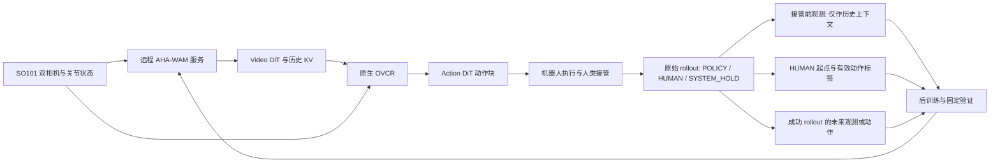

# 写作者交接：AHA-WAM 人类纠正后训练系统与实验主线

写作参考入口已更新为[论文参考骨架](00_PAPER_SKELETON_ZH.md)，从背景到方法与实验自包含地展开。本文件保留为数据、权重及工程事实的核对表。

证据截至 2026-09-13；需要核对工程事实时查阅本文件，不要从所有 `runs/` 目录反向猜论文内容。信息优先级：运行时 `experiment_config.yaml` + 日志/权重存在性 → 冻结 manifest → 当前代码 → 历史说明。两份用户粘贴记录提供了决策经过，但其中取消的方案和早期表述不能直接作为最终配置。

## 1. 当前文章采用的范围

建议研究问题：**短时间的人类纠正如何用于带视频历史和动作 chunk 的 WAM，同时保留纠正发生前的状态上下文，并避免在交还控制处截断完成任务所需的监督？**

这不是单纯“又采了一批 demo”。本仓库已完成的工作包括：远程模型服务与 SO101 数据接口、双相机和六维动作适配、原始交互记录与专家标签分离、接管段逻辑数据视图、跨接管历史读取、停顿感知的时间索引、动作/video 分开的 padding 与监督规则、成功 rollout 的未来延伸、精确多卡来源采样、全量对照和自动训练/固定验证流程。这些是实际系统与设计工作，可据此描述方法；其性能价值仍需要正式对照证明。

适合当前证据的定位是 **context-preserving corrective fine-tuning for memory-based world-action models**。若未来延伸实验证实有效，可加上 **supervision across intervention boundaries**。不要先声称 state-of-the-art、首次、成功率显著提高或达到 DAgger 上限。

建议贡献陈述采用分层写法：

1. 系统贡献：实现真实机器人交互到 WAM 后训练的可审计流程，区分专家动作、上下文观测和等待帧。
2. 方法设计：针对短接管，把历史上下文和可监督目标的边界分开；进一步比较视觉结果延伸与动作完成延伸。
3. 实证贡献（按完成情况定稿）：报告圆柱任务的纠正训练结果，补充第二种插入任务，并通过上下文、未来视觉监督范围和局部恢复评估检验设计的作用。待做实验不列为已完成贡献。

第二条是最值得检验的技术主张，但“首次跨边界取上下文”未经全面新颖性排查，不应如此表述。第三条目前不能写成“两任务均获得提升”。

## 2. 系统架构与算法路径



**继承自 AHA-WAM 的部分**：Video DiT、Action DiT、视频记忆及原生 OVCR；不能把这些骨干结构写成本项目从零提出。SO101 使用全局/腕部两相机和 6 维动作/状态；任务 SFT 从 AHA pretrained 初始化，适配动作维度和本任务分布。

当前配置使用 action horizon=40、action chunk=8、15 Hz 控制；请求返回上限为 8 动作。训练原始视频窗口 49 tick，以间隔 4 采样成 13 张图，经 VAE 后再进入 Video DiT。当前模型支持最多 6 个历史帧，不等于每个样本恰好有 6 帧。

历史图像在训练时以无梯度 prefill 重算 KV，当前特征读取前缀后再传给动作生成。**不需要录制时保存旧 KV，也不是对 HUMAN 前的 POLICY 动作做专家监督。** 当前部署持续缓存历史，训练重新构造有限观测前缀；两者仍非完全等价。

“full”指训练现有训练器选择的 DiT/OVCR 等参数，日志可训练参数为 **7,349,379,396**；VAE/文本编码等不是全部一起更新，不能称每个系统组件均参与训练。历史编码仍 detach。所有本轮 full 从任务 SFT 权重重新初始化，而不是依次从另一个 full 变体继续训练。

## 3. 数据白名单：只把这些放进主实验

| 角色 | 数据 | 训练/验证 |
|---|---|---|
| Cylinder demo | `data/so101_ahawam_cylinder_insertion_v1` | 实际使用 4 个 train session，19,708 帧；一个 val session，661 帧 |
| Power demo | `data/so101_ahawam_power_adapter_v2` | 实际使用 `04_full_remove_and_insert` 下 3 个 train session，15,984 帧；val 1,735 帧 |
| Cylinder 新纠正 | `data/ahawam_hil_raw/so101_ahawam_cylinder_hil_v2` | train 3,460 HUMAN 帧/121 段/82 条含接管 rollout；val 169 帧/7 段/4 条 rollout |
| Power 新纠正 | `data/ahawam_hil_raw/so101_ahawam_power_adapter_hil_v3` | 已存在；4个session元数据共91条轨迹、36,411帧，非HUMAN计数；划分/训练结果待冻结 |

Cylinder HIL-v2 原始集合有 103 条 rollout、43,680 帧，其中 HUMAN 3,629 帧。不是 103 条全自主成功轨迹，也不是 43,680 个专家动作。目录名 `_val` 结尾的 session 整体留作验证；没有把同一 rollout 相邻帧随机拆分。

各任务 demo 的**准确 session 白名单**由原 SFT `model/config.yaml` 和本目录快照给出，不能递归把数据根目录下所有新旧数据都训练进去。归一化沿用任务 SFT stats，不能在纠正集上独立重算后与原基线混用。

排除项：旧 `so101_ahawam_power_adapter_hil_v1/v2` 已被用户判定相机错位；旧 cylinder HIL-v1、no-history、recover-clips、flash/distillation、此前自然混合从 pretrained 重训均不属于当前主线。可在探索讨论中提及，但不能拼进一张声称相同数据的主表。

## 4. 接管边界如何处理

### 4.1 人类动作视图

当前起点来自同时满足 HUMAN control source、intervention、human_action_valid 的连续帧；按原 episode、frame/tick 连续性和 dropped tick 切段。基本模式中，动作越过 HUMAN 段末尾则 padding，padding 不计入 action loss。

原始 POLICY/SYSTEM_HOLD 帧仍保存用于审计与上下文，不全都当专家动作。SYSTEM_HOLD 是等待/保持状态，不能按其名称直接判断对应视觉无信息或该动作一定错误。

### 4.2 接管前上下文

主实验配置为：

```yaml
model.num_history_frames: 6
data.train.correction_history_crosses_segment: true
data.train.correction_history_frame_stride: 48
data.train.correction_history_skip_system_hold: true
```

历史沿同一原始 rollout 往前读取，每次回溯 48 个非 SYSTEM_HOLD 执行帧；时间位置也按执行帧计数。不会跨到别的 rollout。纠正段之前可以是 POLICY，也可能包含更早 HUMAN，不能说历史“全部是纯自主数据”。

已有 [历史核查](../ovcr_rl_token/cylinder_experiments/08_HILV2_HISTORY_ZH.md)在真实抽样中报告：片段内历史平均 0.04 帧、95.5% 冷启动；跨界后平均 2.39 帧、4.5% 冷启动。这是抽样数据审计，不是真机性能提升。

当前训练历史间隔对应 12 个 RoPE 单位；部署每次 prefill 的位置递增是 40/4=10，实际 prefill 内容间隔也可变。因此应说“保留部署可获得的前文”，不能声称完全复现部署 KV 时间分布。跳停顿压缩的是执行时间，不是真实时钟；接触/滑移发生在停顿期间时，压缩也有信息损失风险。

### 4.3 当前论文的两个纠正模式

| 模式 | 当前起点 | 动作标签 | 未来视频目标 | 适用说明 |
|---|---|---|---|---|
| C-H 基本 full | HUMAN | HUMAN 段内 | HUMAN 段内，完整窗口才有 video loss | 已完成、用户观察到恢复动作 |
| C-HV / vidext | HUMAN | 仍在 HUMAN 段内 | 成功 rollout 可延伸到段后非 HOLD 帧 | 视频目标是实际发生的混合控制未来，不是“人类未来” |

延伸受固定 49-tick 查询窗口约束，并不训练整条无限未来。当前 `_FutureWindowRemapper` 延伸到同一成功 rollout 后续执行帧，**没有承诺遇到下一次接管就停止**，所以可能包含后续 HUMAN；也不应把它简单描述为“只加模型合爪动作”。失败 rollout 不延伸。最终 success 是混合人机轨迹结果，不等于所有自主动作都高质量。

未来视频是训练监督目标，不是部署时已知未来。当前视频配置 `action_conditioned=false`，因此这里不能称对 HUMAN 动作的反事实结果建模。视频延伸保持图像/索引一致，但与被截断的 action 标签作用域不同，这正是需要消融的设计。

### 4.4 一个关键更正：C-H 原本就有 video loss

C-H 运行时配置 `lambda_video=1.0`，全训练日志的 `video_supervised_fraction` 均值约 **0.5225**。Demo 有视频监督，HUMAN 由于片段短，有完整 49 帧窗口的理论起点只有 **154/3460=4.45%**。

所以 `vidext` 不是从 action-only 改成 action+video；它增加可接受的视频目标，且改变未来来源/时间线。历史早期训练日志监督比例约 0.77；这是窗口机制生效的证据，不是性能证据。不能用 C-H 对比 vidext 声称隔离了“有无 video loss”。

## 5. 关键权重登记：名称以这里为准

### C-SFT：原 cylinder 基线，已存在

```text
runs/so101_ahawam_cylinder_v1/full_zero2_offload_ahawam_base/formal-cylinderv1-sft-ahawambase-bs4-acc1-4ep-3gpu-20260905-022135/model/checkpoints/weights/step_006572.pt
```

4 epoch，仅原 demo；history=6；init=`checkpoints/AHA-WAM-Pretrained/AHA-WAM-pretrained.pt`。配置在同一 `model/config.yaml`，stats=`runs/so101_ahawam_cylinder_v1/assets/dataset_stats.json`。

### P-SFT：原 power-adapter 基线，已存在

```text
runs/so101_ahawam_padapter_v2/full_zero2_offload_ahawam_base/formal-padapterv2-sft-ahawambase-bs4-acc1-4ep-3gpu-20260901-001743/model/checkpoints/weights/step_005328.pt
```

4 epoch，仅原 demo；history=6；同一 AHA pretrained 出发。配置在同一 `model/config.yaml`，stats=`runs/so101_ahawam_padapter_v2/assets/dataset_stats.json`。

### C-H：跨界历史、基本 full，已完成

```text
runs/ovcr_adapter_cylinder_hil_v2/p1_full_balanced_video_hilv2/model/checkpoints/weights/step_003285.pt
```

从 C-SFT 出发；demo:HUMAN=1:1；3285 步；full lr=1e-5；video loss=1；无 anchor；历史执行帧48跨界；未来不延伸。权重还有 step_001095、step_002190，可作预先规定的开发集选模候选，不能在测试集挑最好的一次。

### C-HV：未来视觉延伸，已由用户部署测试

```text
runs/ovcr_adapter_cylinder_hil_v2_full/p1_full_balanced_video_hilv2_vidext
```

候选最终权重后缀为 `model/checkpoints/weights/step_003285.pt`，实测使用的step待用户核对。该版本从C-SFT独立出发，保持HUMAN动作标签，只延伸成功rollout的未来视频。用户确认共同13个场景首次rollout为6/13，C-H为5/13；部分行为更顺是定性观察。

论文不再列未采用的轻量适配、动作延伸和混合比例探索。历史脚本与冻结证据仍保留，不需删除工程资产。

## 6. 配置与公平对照

| 实验 | 历史跨界 | 跳 HOLD | 未来延伸 | Demo:纠正 | video λ | 初始化 |
|---|---|---|---|---|---:|---|
| C-SFT | 原完整 demo 历史 | 原数据 | 原 demo | 仅 demo | 默认1 | AHA pretrained |
| C-H | 是 | 是，48执行帧 | 无 | 1:1 | 1 | C-SFT |
| C-HV | 是 | 是 | video | 1:1 | 1 | C-SFT |

当前纳入的配置比较为C-H vs C-HV，检验未来视频目标延伸。未完成的实验入口不列入本文复现表。

统一每卡 batch4 ×3卡、accumulation1、global batch12、bf16、ZeRO2 CPU offload，seed42。C-H 系列3285步、每1095步保存、每219步验证。1:1 共抽取19,710 demo起点和19,710纠正起点，约1遍demo/5.7遍HUMAN。来源内部打乱不放回，耗尽再循环。

这是相同更新步数/名义 batch 预算，**不等于相同墙钟计算量或有效动作标签数**。延伸提高有效监督数量；历史与 video 改变前向开销。纠正后训练不是再次4个全数据epoch。新 power 入口保留任务原预算2664步，归一化为相同一遍demo来源预算，而非与 cylinder 强制相同步数。

## 7. 已有结果能说到哪一步

最新用户确认：相同13个初始化场景、各模型第一次rollout，C-SFT为1/13（7.7%），C-H为5/13（38.5%），C-HV为6/13（46.2%）。此前7/17–9/17指两个模型分别在包含额外重复试验时的汇总；不与首次试验混合，也不擅自分配总计数。首次试验口径是回溯澄清，不声称预注册；尚缺逐场景结果与测试step，不能从三个总计数计算配对显著性。记录来源见[user_report_results.json](user_report_results.json)。

可报告观察到抓取对准与插入偏差后的定向微调。C-HV“更顺”目前为定性观察；用恢复耗时与重复尝试统计后才能作指标结论。当前证据支持整个纠正训练配方的初步收益，不能分别归因于视频辅助目标、历史处理或Video DiT更新。

此前关于SFT更好的印象没有系统计数，不证明硬件精度下降。低成本平台可写进实验设置；硬件鲁棒性需要受控偏差或跨时段测试。power v3留待训练与自主评估，不沿用旧相机结果。

## 8. 作者只需沿这些代码入口阅读

| 入口 | 真实职责 |
|---|---|
| [hil_human_only_dataset.py](../../scripts/so101_pipeline/hil_human_only_dataset.py) | HUMAN逻辑段、历史跨界、执行帧位置、未来重映射与mask |
| [robot_video_dataset.py](../../src/ahawam/datasets/lerobot/robot_video_dataset.py) | 原始窗口、视频采样、chunk观测与历史构造 |
| [ahawam.py](../../src/ahawam/models/wan22/ahawam.py) | 历史prefill、action/video flow目标、训练推理路径 |
| [mot.py](../../src/ahawam/models/wan22/mot.py) | 原生OVCR读写和Video/Action专家交互 |
| [samplers.py](../../src/ahawam/utils/samplers.py) | 来源循环与精确全局比例 |
| [run.py](../../scripts/so101_pipeline/ovcr_adapter/v2_experiments/run.py) | 当前有效full训练入口与固定验证 |
| [prepare_hil_v2.py](../../scripts/so101_pipeline/ovcr_adapter/cylinder_experiments/prepare_hil_v2.py) | 冻结本轮cylinder HIL-v2数据和主配置 |
| [prepare_hil_v2_full.py](../../scripts/so101_pipeline/ovcr_adapter/cylinder_experiments/prepare_hil_v2_full.py) | 当前full变体生成器，论文只使用vidext配方 |
| [check_history_crossing.py](../../scripts/so101_pipeline/ovcr_adapter/cylinder_experiments/check_history_crossing.py) / [check_future_window.py](../../scripts/so101_pipeline/ovcr_adapter/cylinder_experiments/check_future_window.py) | 真实帧历史/未来映射核查 |
| [run_action_server.sh](../../scripts/so101_pipeline/online_deploy/run_action_server.sh) | 服务脚本内选择部署YAML；并不默认读取settings_dagger.yaml |
| [wam_policy_server.py](../../deploy/server/wam_policy_server.py) | 模型服务入口 |

旧训练归档路径和已取消 `_winA/_winB` 不作为复现实验入口。原始采集协议背景可看 [SO101 HIL handoff](../hil/SO101_AHAWAM_HIL_DATA_COLLECTION_IMPLEMENTATION_HANDOFF_ZH.md)，但机器人侧客户端实际版本应另存commit/配置，不从交接说明推断所有内容均已运行。

部署 C-H 当前YAML是 [cylinder_v2_p1_full_balanced_video.yaml](../../scripts/so101_pipeline/online_deploy/deployments/cylinder_v2_p1_full_balanced_video.yaml)：history6、cylinder stats、指令 `Pick up the cylinder and insert it into the matching hole.`。Power 指令 `Remove the power adapter from the holder and plug it into the power strip.`。历史记录曾记载cylinder部署误用power stats/指令；本次所读配置已正确，旧错误配置下的视频不应当训练方案效果证据。

## 9. 推荐论文图表与写作骨架

主图：同一rollout时间轴，用不同色区分POLICY/HUMAN/HOLD，画出三种不同跨度：历史上下文、action mask、video target。旁边画双DiT与原生OVCR，以及实际更新范围。图里不要放不存在的critic或reward网络。

结果图：两任务完整成功率；cylinder的C-cut/C-H/C-HV/C-HVA机制链；抓取完成与插入完成的失败分解。数据审计图：有效历史长度分布、有效动作/video监督比例、交还后合爪发生位置。它们比堆很多不可比较的旧checkpoint更能体现技术工作量。

正文结构：短纠正的时序问题 → 数据构造与目标 → 系统与训练协议 → cylinder已有结果及power位置 → 未来视觉范围对照与恢复观察 → 局限。已给出的汇总先按用户报告登记，逐模型计数核对后填写正式表格；草稿可先搭框架和标明待测，不能把预计提升写成已测结论。
