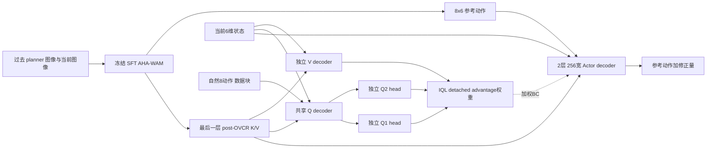

# 103 episode 离线 RL 系统：实现、数据契约与运行入口

> 2026-10-25：9条缺成功帧的录像已确认是提前录制截断，不是失败，也不应补标最后一帧成功。纳入方案、bootstrap边界和critic泛化证据见 [10专项调研](10_CRITIC_GENERALIZATION_AND_CENSORED_EPISODES_ZH.md)。本轮未改当前基线训练数据。

日期：2026-10-24。本文件是本轮实现的当前说明，优先于 01–07 中尚在讨论的时序与表征方案。实测资源、文献参数和后台运行状态见 [09 参数与资源报告](09_PARAMETERS_AND_RESOURCE_REPORT_ZH.md)。

## 1. 已落实的选择

- 冻结采集 HG-DAgger 时使用的 SFT `step_006572.pt`，路径见 [缓存部署配置](../../scripts/so101_pipeline/offline_rl/configs/cylinder_sft_cache.yaml)。不是后来 DAgger 的 `step_003285.pt`。归一化统计与该 SFT run 的 `model/dataset_stats.json` SHA256 相同。
- 只去掉 SYSTEM_HOLD 的动作，保留 POLICY 与 HUMAN 实际执行动作；不修改原始视频、parquet 和标注。
- 当前帧先于当前行的命令。成功画面 T 对应上一行命令产生的结果。
- 先做 chunk-IQL，再做同架构 TD3+BC 对照；两者分别初始化小网络，共享同一份冻结模型缓存。TD3+BC 不从 IQL 的 optimizer 状态接续。
- actor 直接读取最后一层 post-OVCR K/V，不需要先训练 RL-token 重建 reader。旧 reader 路线仍保留用于消融。

## 2. 动作块和奖励的精确定义

`skip_hold` 构造器选一个非 HOLD 的原始观察 t，从 t 起向后取 8 个 POLICY/HUMAN 命令，索引为 `i0=t, ..., i7`；Q 与 actor 的数据标签均是这 8 个自然命令。后继观察是原始帧 `i7+1`，不是下一个非 HOLD 命令所在帧。如果 i7 是一段 policy 最后一个命令，i7+1 正好可以是第一张 HOLD 图像。

成功帧转换为 T*：若 `control_source[T-1]==HOLD`，沿前一个连续 HOLD 段回溯到第一张 HOLD 图像；否则保留 T。于是 HOLD 第一帧成功不移动；HOLD 内部成功与 HOLD 后第一张 POLICY/HUMAN 图像成功都前移到对应 HOLD 段首。标注文件保留原始 T，样本 metadata 同时保存 T、T* 和奖励在块中的位置。

只从 `t<T*` 启动成功 episode 的训练样本。若 `t<T*<=i7+1`，设 `R=gamma^j`，其中 `ij=T*-1`；`discount=0`。**动作标签仍完整保留自然尾部，可跨过成功**。因此成功后退出动作也可能成为 BC 标签，这是用户本轮选定的目标，不再做旧方案的 terminal-prefix 截断或重复末动作。成功后不会另起新的训练样本。

普通块 `R=0, discount=gamma^8`；失败 episode 最后一个完整窗口设 discount=0。这里 gamma 默认 0.997，单位改为一个保留的有效命令，8 动作折扣约 0.97625。HOLD 的墙钟时间记录在 `duration_ticks/seconds`，不再参与训练折扣。旧参数名 `gamma_tick` 为兼容保留，不能把它理解成 skip_hold 仍按原始 tick 打折。

例：原始动作来源 `P,P,H,H,P,P,P,...`，取 4 动作时命令来自 `[0,1,4,5]`，后继观察为 6。成功图像标在 3 或 4，都会前移到 2，由命令 1 取得奖励；输入 Q 和监督 actor 的仍是 `[a0,a1,a4,a5]`。

边界处理：

- 录像尾部不足 8 个有可观察结果的命令时不造样本，不补零、不补重复动作。
- 不能跨 episode、缺失控制 tick 或 dropped frame 拼接；HOLD 是有日志的等待，可以跳过其命令，缺失日志则不能假定为 HOLD。
- stride=1，在非 HOLD 命令序列上滑动。重叠窗口中的多个正奖励样本只来自同一次成功事件。
- HUMAN 与 POLICY 可以混合；原始 `control_source` 只作审计，不作为 actor 可见的未来标签。

这是一项**压缩等待时间的建模近似**。机械臂可能在 HOLD 时继续到位；删掉等待命令后，数据动力学未必等同于在线连续执行 8 动作。另一个近似是：非终止 s' 可为第一张 HOLD 图像，而数据的 s 只从有效命令帧启动，V(s') 可能缺少直接监督。当前按用户定义落实并保留所有原始帧缓存，之后可比较 tick 模式与 next-active 模式；不能仅凭 Bellman loss 宣称这两点已被解决。

## 3. 缓存存什么、如何产生

[cache.py](../../src/ahawam/offline_rl/cache.py) 为全部 103 条录像的全部原始观察各存一次，HOLD 观察也导出，因为它们可能作后继、planner 历史或成功画面。每个 128 观察的分片写成 `*.safetensors` 和一个索引 JSON；只在张量完整写入、校验后发布索引，训练只读取有索引的完整分片。

| 字段 | 每观察形状 | 精度 | 用途 |
| --- | --- | --- | --- |
| k / v | 各 `[120,3072]` | BF16 | planner 最后一层经过当前图像 OVCR 更新后的原始 cache |
| routed | `[32,3072]` | BF16 | OVCR query 对原 planner KV 加权读取的 V；未解码回 120 个 token |
| projected_query | `[32,3072]` | BF16 | 最后一层 layer_query_proj 后的 query，供路由审计 |
| state | `[6]` | FP32 | 当前关节状态，经原 processor 归一化 |
| reference | `[8,6]` | FP32 | 当前图像下原 Action DiT 生成的归一化参考动作 |

`routed` 和 `projected_query` 通过 MoT 的可选导出探针采集，普通服务不设置开关时不持有额外张量。该探针不改变路由与 KV 的计算结果。

metadata 包含原始 run/episode/frame、planner anchor、offset、历史帧列表、source、checkpoint/config/代码/视频/parquet hash、dtype、归一化 scale/offset、分片校验和。原始 action、奖励、终止、next-frame 关系在单独 `transitions.pt` 中，避免为每个 transition 重复存 s/s' 的大 KV。

`ShardedCache` 使用 safetensors 按行读取和有上限的映射 LRU；不会把约 76GiB 特征整体 stack 到 RAM/GPU。当前 batch 拼接原 K 与 V 后传入网络，网络再分开投影；数据搬运是 BF16，小网络更新用 FP32。

### Offset 与因果历史

从实际 SFT `model/config.yaml` 核对：最大 action_offset=7、chunk=8、horizon=40、视频采样窗口 49、history=6；其数据集历史间距为 `num_frames-1=48` 个原始控制帧。

当前提取协议为 `causal_independent_anchor_v2`：在每段连续日志内，每 8 个**原始帧**固定一个 planner anchor b，当前 t 取得 offset=t-b，覆盖 0…7；对 b 前最多 6 个间隔 48 的历史观察执行因果 planner prefill，再对 b prefill。OVCR 与 Action DiT 始终读取 t 的当前图像和本体状态，生成该状态的参考块。复用同一 b 的 planner 结果，改变本地 query；动作分支在每次查询前重置到 chunk index 0。

这是确定性的 offset 覆盖，每帧只存一个 conditioning 版本，避免八倍缓存。它保留了“旧 planner＋当前 local observation”的机制，但不是对原异步采集隐藏状态的重放，也不是完整复现原训练中五个 chunk 的所有 offset/context 组合。没有读取未来图像。缺失 tick 处重置 anchor 和历史；RoPE 位置使用原始帧号除以 4。后续训练 actor/Q 只需缓存与当前 state/reference/数据动作，不再推理 planner，也不在特征固定之后改变 offset。

如果以后要求同一观察每个 epoch 随机换 planner age，需要提前导出多个版本或在线重算，不能把已有 post-OVCR KV 简单改一个 offset 数字当成新特征。后续部署须遵守相同的 conditioning 协议再评估，直接接回旧异步服务不能视为分布完全一致。

## 4. Actor、双 Q 和 V

[networks.py](../../src/ahawam/offline_rl/networks.py) 的 `architecture=raw_kv` 是当前主线：

1. 原 K 与 V 分别 LayerNorm＋Linear：3072→256；空间位置嵌入加在 K 上。投影在各模块内部训练，各自拥有参数。
2. Actor：1 个状态 token＋8 个参考动作 token＋动作时序位置，经过 2 个 decoder block。每个 block 为 pre-norm self-attention、cross-attention、4×FFN 的残差结构；4 heads，width=256。
3. 每个动作 token 通过两层 256 MLP 输出 6 维修正量，加到参考动作，裁剪到原归一化范围 [-5,5]。最后一层零初始化，因此无 dropout 的初始 actor 恰好等于参考策略。训练时 reference 有 10% 概率整体置零。
4. Q：1 个状态 token＋8 个**候选/数据动作** token，经同类 decoder，按顺序展平成 2304 维，再送两个独立的 `256→256→1` MLP head。默认共享注意力主干。Q 不接收 reference，不接收 future source/success/valid-length 标签。
5. V：独立的状态 query decoder＋MLP，只读 KV 与当前状态，不输入动作。



参数量：actor 3,863,814；共享双 Q 5,043,970；V 3,860,481。加上 target networks 仍远小于原 WAM。3072 输入只决定第一层投影的大小，**不会强迫每个 actor block 都有 3072 宽度**。没有扩散 timestep、30 层去噪或多轮生成。

设计参考 HALO-WA 的 state/reference action token→self/cross attention→MLP 结构；独立实现适合本项目 last-layer K/V 的小宽度版本。HALO 的实际视觉输入、规模和优化目标不同，见 [参数报告](09_PARAMETERS_AND_RESOURCE_REPORT_ZH.md)。没有直接拷贝其分布式训练框架，也没有宣称复现 RLT 的 learned RL token。

共享双 Q 节约计算、符合用户首选，但两个 head 的误差相关性可能更高；`--independent-q` 让每个 Q 都拥有自己的 decoder。Actor、Q、V 之间始终不共享可训练参数，避免不同 loss 互相改写同一个视觉投影。

## 5. 更新、恢复与推理接口

[learner.py](../../src/ahawam/offline_rl/learner.py)：IQL 每次 minibatch 各更新一次 V、Q、actor；actor 是 detached advantage 加权 BC，target Q 每次 EMA。TD3+BC 每次更新双 Q，每 2 次更新 actor 与 target Q/actor；本轮已将 TD3 的 target cadence 对齐原版延迟更新。旧文档 06 中“原型每 Q 步更新 target Q”的说明仅对应改造前。

前 200 次仅 BC actor，随后同步 target actor，再进入 RL。该阶段不训练 Q/V，也不是 critic warmup。算法配置、优化器、target、CPU/CUDA RNG、数据与特征 provenance 都随 checkpoint 保存。断点恢复须使用相同数据、缓存、参数和 split；`--steps` 表示本次再做多少步。

[inference.py](../../src/ahawam/offline_rl/inference.py) 提供 `FrozenKVActor.action(last_k,last_v,normalized_state,normalized_reference)`，返回归一化动作与反归一化绝对关节目标，不连接机器人。真机成功率评估与在线 replay/actor 同步仍是后续阶段，本轮跑的是离线系统。

## 6. 文件与命令地图

| 内容 | 入口 |
| --- | --- |
| 原始数据验证、成功前移、skip_hold 构造 | [data.py](../../src/ahawam/offline_rl/data.py) |
| BF16 KV/routed 导出、分片与 mmap batch | [cache.py](../../src/ahawam/offline_rl/cache.py) |
| 小 actor、共享/独立双 Q、V | [networks.py](../../src/ahawam/offline_rl/networks.py) |
| IQL/TD3+BC 更新、target 与 checkpoint | [learner.py](../../src/ahawam/offline_rl/learner.py) |
| 原始数据 prepare、旧 pooled/readout 消融 | [run.py](../../scripts/so101_pipeline/offline_rl/run.py) |
| 四卡调度、依次训练、状态、单卡训练 | [system.py](../../scripts/so101_pipeline/offline_rl/system.py) |
| 多 batch size 真实缓存资源基准 | [benchmark.py](../../scripts/so101_pipeline/offline_rl/benchmark.py) |
| SFT 模型配置 | [cylinder_sft_cache.yaml](../../scripts/so101_pipeline/offline_rl/configs/cylinder_sft_cache.yaml) |
| 时间对齐、缓存、梯度与恢复测试 | [test_offline_rl.py](../../tests/test_offline_rl.py) |
| 本轮数据数字与待处理 episode | [audit_20261024.json](audit_20261024.json) |

以下命令从仓库根目录执行，使用已有 ahawam 环境：

```bash
export PYTHONPATH=src:.
PY=/home/fenghao/miniconda3/envs/ahawam/bin/python
OUT=runs/offline_rl/cylinder103_skip_hold

# 1. 原始数据 → 轻量 transition 索引与审计
"$PY" scripts/so101_pipeline/offline_rl/run.py prepare \
  --roots data/ahawam_hil_raw/so101_ahawam_cylinder_hil_v2/* \
  --output "$OUT/data" --temporal-mode skip_hold --stride 1

# 2. 四张卡各放一个冻结 WAM 副本，按 episode 分工；完成后单卡依次跑两个 500-step pilot
"$PY" scripts/so101_pipeline/offline_rl/system.py sequence \
  --transitions "$OUT/data/transitions.pt" --cache "$OUT/cache" \
  --gpus 0 1 2 3 --pilot-steps 500

# 3. 查看分卡进度、显存、累计耗时和完成标记
"$PY" scripts/so101_pipeline/offline_rl/system.py status --cache "$OUT/cache"

# 4. 另测 32/64/128 batch size；记录在 profile JSON，不是真机评估
CUDA_VISIBLE_DEVICES=0 "$PY" scripts/so101_pipeline/offline_rl/benchmark.py \
  --transitions "$OUT/data/transitions.pt" --cache "$OUT/cache" \
  --output "$OUT/resource_profile.json" --batch-sizes 32 64 128

# 5. 评估 pilot 后的较长候选运行；两种算法分别从头开始
CUDA_VISIBLE_DEVICES=0 "$PY" scripts/so101_pipeline/offline_rl/system.py train \
  --transitions "$OUT/data/transitions.pt" --cache "$OUT/cache" \
  --output "$OUT/iql_5000" --algorithm iql --steps 5000 --batch-size 64
CUDA_VISIBLE_DEVICES=0 "$PY" scripts/so101_pipeline/offline_rl/system.py train \
  --transitions "$OUT/data/transitions.pt" --cache "$OUT/cache" \
  --output "$OUT/td3_bc_5000" --algorithm td3_bc --steps 5000 --batch-size 64
```

`sequence` 出错会终止其余缓存 worker，保留已完成分片；原命令可恢复。运行前检查同一 cache 下旧 worker 已退出，避免重复写同一 rank。每个 worker 的日志为 `cache/worker_rankN.log`，进度为 `progress_rankN.json`，完成为 `done_rankN.json`。全量索引检查后写 `cache/complete.json`；IQL、TD3 的 pilot 顺序日志在 OUT 下，最终写 `sequence_done.json`。长训练只需一张卡，可用于不同 seed 的并行实验；本轮缓存四卡是推理并行，不是把单份模型切到四卡。

训练默认保留目录名 `_val` 的整条 episode 作验证；当前成功标注未齐的 val episode 暂时排除。训练按窗口均匀有放回采样；验证每次固定最多 256 个窗口，不用它们更新参数。损失、Q 分歧、参考动作误差、加载耗时与显存写 metrics，模型/优化器写 last.pt，完整配置与参数量写 config.json，训练资源汇总写 profile.json。离线误差和 Q 值不等于真机成功率。


补充审计：没有成功窗口的2条分别为 `20260911_225809/episode_000017` 与 `20260912_010747_val/episode_000002`。两条成功都标在HUMAN→POLICY切换处，成功图像的incoming相邻记录 tick 差分别15和14，存在未记录时段，并非自然尾部不足8动作。当前不推断这些缺失tick全部是HOLD，因此不跨该缺口构造奖励transition；缓存与原始标注仍完整保留。之后若能从独立控制日志恢复实际执行/等待，可再纳入这两个事件。
