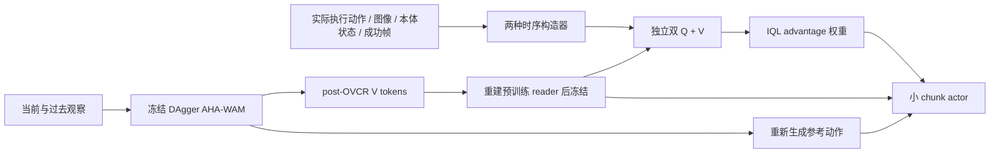

# AHA-WAM：103 episode 上的离线 RL

2026-10-26 最新重建：[新数据划分、9 条未观测成功片段、4 条前半段视频、两条失败验证及四卡→IQL/TD3 队列](18_REBUILD_AND_EPISODE_RECIPE_ZH.md)。特殊处理永久保存在本轮 `data/episode_recipe.json`；异常汇总见 [19 数据异常与处理记录](19_DATA_ANOMALIES_ZH.md)。

2026-10-26 时间轴修正：[暂停不拆 episode：证据、代码、转移与 history 覆盖率变化](17_EPISODE_CONTINUITY_CORRECTION_ZH.md)。新连续转移已准备；旧 cache、三项模型和价值视频仍使用此前的 tick 跳号过滤协议，尚未重新导出/训练。

2026-10-25 在线比较：[三个策略的 YAML、GPU/端口、原 action server 启动方式与 history 近似](16_ONLINE_DEPLOYMENT_ZH.md)。

2026-10-25 价值检查：[全量 103 条价值视频、Q/V 分数含义、提前截断轨迹及定量统计](15_VALUE_VIDEO_DIAGNOSTICS_ZH.md)。入口 `runs/offline_rl/value_videos_20261025/index.html`。

2026-10-25 实验启动：[三项实验的运行安排、原生 Action DiT LoRA 实现、日志与恢复方式](14_THREE_EXPERIMENTS_RUNBOOK_ZH.md)。cache 已完成，IQL 与 TD3+BC 各 10,000 步独立运行；IQL 加权 Action DiT 在第一项结束且真实验证通过后接续。

2026-10-25 损失核查：[TD3+BC 的真实数据动作监督、reference 的角色及 RLT/VINE 的区别](13_TD3_BC_TARGETS_AND_REFERENCE_ZH.md)。

2026-10-25 内部 actor 讨论：[IQL 加权 flow matching 直接微调 Action DiT、与 VINE 的梯度区别及缓存限制](12_IQL_WEIGHTED_FLOW_ACTION_DIT_ZH.md)。这是可行的内部路线候选，尚未切换当前外部 actor 或后台队列。

2026-10-25 运行补充：[GPU利用率、剩余时间与双副本隔离测试结果](11_GPU_UTILIZATION_AND_CONCURRENCY_ZH.md)。测试已结束，原四卡单副本任务继续。

2026-10-25 补充：[提前截断录像、零奖励监督与 critic 泛化专项调研](10_CRITIC_GENERALIZATION_AND_CENSORED_EPISODES_ZH.md)。用户已确认9条不是缺标注待补，而是录像在完整成功前提前结束；继续导出其缓存，当前基线仍排除，尚未按失败纳入。

2026-10-24 当前方案已按用户选择实现：**冻结采集用 SFT step_006572 → 最后一层 post-OVCR 原始 KV → 小型 attention actor＋共享双 Q＋独立 V → 先 IQL、再 TD3+BC 对照**。动作只删 HOLD，保留 POLICY/HUMAN；成功按 HOLD 规则前移，动作块自然跨成功，terminal 不自举。

先读 [08 系统实现与命令地图](08_SYSTEM_IMPLEMENTATION_ZH.md)，再读 [09 文献参数、资源实测与运行报告](09_PARAMETERS_AND_RESOURCE_REPORT_ZH.md)。本轮数据数字与9条缺标注轨迹见 [audit_20261024.json](audit_20261024.json)。全量103条缓存和已就绪轨迹的训练分开处理，不把未定位的成功当成失败。

- [01 原始数据与三种时序的早期讨论](01_DATA_AND_TEMPORAL_CHOICES_ZH.md)
- [02 旧 pooled/readout 原型运行说明](02_RUNBOOK_ZH.md)
- [03 论文与公开代码审计](03_LITERATURE_AND_CODE_AUDIT_ZH.md)
- [04 真实部署生成8步与planner布局40的区别](04_DEPLOYMENT_CHUNK_LENGTH_ZH.md)
- [05 成功边界与不同终止动作块的文献行为](05_SUCCESS_BOUNDARY_AND_TERMINAL_CHUNKS_ZH.md)
- [06 Actor/critic更新、UTD与在线/离线调度](06_ACTOR_CRITIC_UPDATE_SCHEDULES_ZH.md)
- [07 原始KV容量静态估算](07_PLANNER_KV_STORAGE_ESTIMATE_ZH.md)

以下保留2026-10-23的初始方案与研究论证，**其中“DAgger checkpoint、先训练reader、保留HOLD或终止prefix”的候选选择已由08的新决定覆盖**。早期CPU smoke结果不能视为本轮真实WAM训练结果。

## 1. 对当前设想的判断

“冻结已经完成 DAgger 的 AHA-WAM，用内部表征、关节状态和参考动作，另训动作块 actor＋双 Q”是合理首试。它属于 **RLT/HALO-WA 启发的外部动作策略适配**。它不会通过奖励更新原 Action DiT 权重。

严格说，它既不是原版 RLT，也不等同于 HALO-WA：

| 部分 | RLT | HALO-WA 公开实现 | 本项目候选 |
| --- | --- | --- | --- |
| 表征 | VLA 内部 embeddings，经重建训练为 RL token，然后冻结 | 冻结 WA 的 VAE 条件 latent，经可训练视觉压缩与 attention | 优先试 post-OVCR Video→Action V；可先重建为 frozen token，也可直接 attention |
| actor | 参考动作条件的小 Gaussian chunk actor | attention 融合后输出完整动作块 | 小 MLP，或读取多 token 的 attention；输出完整 8×6 块 |
| critic | token＋本体状态＋候选动作块 | 视觉 token＋本体状态＋参考/候选动作 | 两个独立 Q；候选动作按时间展平，参考只输入 actor |
| 奖励/优化阶段 | 主要是在线 off-policy RL | 主要是在线 TD3 风格＋BC | 固定旧数据，优先 IQL，另有 TD3+BC 对照 |

RLT 的 token 是经过额外训练的信息瓶颈，不是任意选取的 hidden state。其 actor 评价的是 **完整动作块**；Q 可以接收动作块，你这一点的理解正确。论文还明确指出参考动作帮助小 actor 保留生成策略的行为模式。[RLT 方法与附录](https://arxiv.org/html/2604.23073v1)

HALO-WA 的分布式 latent 读取更接近“直接利用多个 WAM token”；但本地公开代码的实际输入来自 VAE 条件分支，不能把它说成已经验证了本项目的 OVCR K/V 表征。[HALO-WA 论文](https://arxiv.org/html/2607.04265v1)，[审计的公开实现](https://github.com/YeanRoot/HALO-WA/tree/611008193fd3438bf99cc8f8377858fbdfcb9555)

## 2. 我推荐的首版结构

首版主线：**固定 DAgger checkpoint → 因果重算特征/参考 → reader 预训练并冻结 → 小型双 Q＋V 的 chunk-IQL → 外部 actor**。建议以 `z=256`、两层宽 256 MLP 开始，而不是训练大型 VLM critic。多 token attention 版本作为表征压缩消融。完整步骤见 [运行说明](02_RUNBOOK_ZH.md)。

本轮实现的 attention 是“有位置的视觉 token 读出＋按顺序展平的动作块”，不是 HALO 的原样 hybrid-attention 复现。也未直接把 action tokens 作为 cross-attention query；如该机制成为研究主张，需要另加动作条件读取消融。

## 3. 为什么离线阶段优先 IQL

双 Q 能缓解一部分高估，但两个网络可能同时对数据外动作高估。把在线的 `max Q + reference BC` 直接应用于小型固定数据，并不能保证离线稳定。

IQL 的价值更新仅查询实际记录的动作，通过 expectile V 和 advantage 加权策略提取实现改进；无需先把尚不可靠的 actor 生成动作输入 TD target。这是选择它作为首版的原因，不是声称它一定胜过 TD3+BC。[IQL 论文](https://arxiv.org/html/2110.06169)，[作者实现](https://github.com/ikostrikov/implicit_q_learning/blob/master/critic.py)

定义固定状态表示 `h=(frozen features, proprio)`，实际执行块 `A`，累计奖励 `R`，已含终止语义的折扣 `d`：

$$
\bar Q(h,A)=\min_iQ_i^{target}(h,A),\qquad
L_V=\mathbb E[|\tau-\mathbf1[\bar Q-V<0]|(\bar Q-V)^2],
$$
$$
y=R+dV(h'),\quad L_Q=\sum_i\mathbb E[(Q_i(h,A)-y)^2],
$$
$$
w=\min(\exp(\eta[\bar Q-V]),w_{max}),\qquad
L_\pi=\mathbb E[\operatorname{sg}(w)\,\mathrm{MSE}_{valid}(\mu(h,A^{ref}),A)].
$$

当前外部 actor 使用固定方差 Gaussian 的均值形式，训练为加权 MSE，执行默认取均值；没有在线探索采样器。这是有界均值、terminal-prefix mask 和参考条件下的 IQL 适配，而非逐行复现原作者代码。

IQL 中数据动作是提取目标，WAM reference 是输入。可选额外 reference penalty，默认 0；并不把失败 policy 动作冒充专家标签，而是让价值权重决定其学习强度。若权重几乎相等，它会接近混合行为 BC；必须和同网络、同数据的 BC 对照。

TD3+BC 对照采用 target actor、target smoothing、双 Q、延迟更新，以及 `alpha / mean(abs(Q))` 的尺度归一。其 BC 对齐数据动作；这和“只惩罚偏离 WAM reference”的在线 RLT loss 有区别。[TD3+BC 作者实现](https://github.com/sfujim/TD3_BC/blob/main/TD3_BC.py)

## 4. 奖励：可以从成功 1、其他 0 开始

把首个标出的成功观察 `s_k` 作为任务终点：`r_(k-1)=1`，更早转移奖励 0，`k` 后数据不参与 RL；不对成功后的每个画面反复给 1。失败 manifest 的轨迹保留到最后可构造的转移，奖励全 0。末帧 action 没有后继观察，不能凭空构造最后一步。

这是根据用户描述采用的 **first-marked-success 合同**。当前 6 份 JSON 的 `reviewed_labels` 都为空，因此不能把这些帧额外宣称为逐帧分类器的已审阅负样本，也不能宣称标注工具的 `success_event.valid` 已经为真。成功但尚无正标注的其他 episode 将标为 pending，而不是自动标负。

若动作块跨过 `k`，仅计算真实执行到 `k` 的前缀：

$$
R_t=\sum_{j=0}^{m-1}\gamma^jr_{t+j},\qquad
d_t=\gamma^m\mathbf1[\text{允许 bootstrap}].
$$

成功前最后一步在一个 m 步块中时，块奖励是 `gamma^(m-1)`。primitive reward 仍然是 1。折扣按控制 tick 定义，与每块随意固定一次 gamma 不同。

原始成功标签的视觉延迟、相机 age、关节运动滞后仍存在：在观察前一行给奖励是数据合同层面的对齐，不是证明某一动作物理上独立导致了插入。若判据是“插入后松手”，必须全数据统一；不能一部分标插入、一部分标释放。

首轮不建议同时加入距离、接触力猜测、每次接管惩罚或学习型 VLM reward。先验证稀疏奖励能否形成可靠价值。后续若用势函数 shaping，应使用一致的时间折扣与 `gamma^m Phi(h')-Phi(h)`，不能任意加“接近成功图像”的分数。

## 5. 动作块与 hold：本轮不替你定案

详见 [数据与时序说明](01_DATA_AND_TEMPORAL_CHOICES_ZH.md)。同一批数据已得到：

| 构造 | 样本数 | 成功终止样本数 | 主要意义 |
| --- | ---: | ---: | --- |
| 连续 tick，C=8、stride=2 | 1,358 | 24 | 所有实际命令含 hold；重叠窗口复用成功 |
| 原 policy/HUMAN 命令块＋后续 hold，最多 C=8 | 168 | 6 | 更贴近当前部署块，等待作为环境时间 |
| 连续 tick，C=1、stride=1 | 2,829 | 6 | 最直接的奖励/转移诊断 |

**我在调研后的倾向是：C=1 做数据诊断，宏动作做首个与现有 chunk 部署一致的主实验，tick-C8 做消融。** 原因是当前 collector 的计算等待是执行器行为，通常无需教 actor 主动生成这么多等待命令；宏动作又能保留等待中发生的成功。但必须先固定新 RL 执行器的等待协议，不能认为宏动作天然解决延迟问题。这一项仍等你决定。

## 6. Critic 的具体选择与预训练

优先两个独立的 `MLP(256,256)` Q。每个 Q 输入 frozen z、当前 6D proprio、按顺序展平的 8×6 候选动作；另有同规模 V。actor 额外输入参考块。这样先检验“现有表征够不够”和“奖励能否传播”，而不是同时调大量 attention 结构。

特征来源建议比较：① post-OVCR V＋reader；②相同 V 的多 token attention；③当前观测 VAE / 独立预训练 RGB encoder。①最贴近你的接口直觉，②检查信息瓶颈是否丢空间细节，③检查复杂预测缓存是否真有额外价值。当前可运行 exporter 实现①②共用的 post-OVCR V 源；③尚未实现。

当前实现的 proprio 是已有的 6D 关节位置，没有力/触觉或速度。若精细阶段可观测性不足，可增加仅由过去帧计算的关节速度、观测 age 和缓存 age；不能用 `next_state-state` 作为当前输入。最初应先测现有 frozen 表征，而非把这些未对齐字段一次全部拼入。

需要复用的是 **视觉/动作先验** 的预训练权重。Q/V 从随机初始化开始：HALO/RLT 的 Q 对应其他机器人、任务、动作坐标和折扣，不能直接作为 SO101 的数值价值先验。若单纯图像表征不足，可借鉴 HIL-SERL 的 frozen pretrained ResNet-10＋小头，而非引入大 VLM Q。[HIL-SERL 实际网络工厂](https://github.com/rail-berkeley/hil-serl/blob/main/serl_launcher/serl_launcher/agents/continuous/sac.py)

本地 HALO 的 `CrossAttentionCritic` 没有候选动作位置编码，也没有 self-attention；对候选 token 独立 cross-attention 后做 mean pooling。在该独立类上倒序动作，测得最大 Q 差约 `1.86e-9`。这是对本地指定提交/模块的检查，不代表论文实机私有代码也相同。本项目用有序 flatten 避免这种对动作顺序不敏感的结构；详见 [来源审计](03_LITERATURE_AND_CODE_AUDIT_ZH.md)。

## 7. 数据规模、接管与验证

这批只有 7 条轨迹、1 条失败，适合功能验证，不能据此选择最优算法。样本窗口更多不会增加独立成功次数。后续六批数据均通过显式多 `--roots` 支持，标注未完成的成功轨迹会跳过；本轮只读测了指定的 `20260911_183057`。

默认 `mixed` 保留所有控制来源及接管后的价值传播，学习的是数据中可达到的好行为，包括人类恢复。它不是对“完全无人干预原策略成功概率”的无偏估计。另有 `censor` 对照，在 POLICY/hold→HUMAN 前停止 bootstrap；这改变学习目标，也可能把可恢复状态压成低值，不应自动视为正确答案。HUMAN 动作不是负奖励，hold 不是无效帧。

按 episode 切分，reader 也只能使用训练集。完整数据优先再按采集批次留出；不能随机把相邻帧拆成 train/val。只有一条失败的当前批次无法在训练/验证两侧同时包含独立失败样本。

需要记录 Q 越界比例、双 Q 分歧、validation Bellman error、优势权重 ESS、reference 偏离、关节动作变化量；进一步做 token 置零/打乱、动作顺序/小扰动敏感性检查。单次终止 0/1 回报下真实 Q 应在 [0,1]，但 Q 不是无条件成功概率；当前只监控越界，没有用 clamp 掩盖估值问题。

Q 能区分成功/失败轨迹并不足以证明它能对同一状态的不同动作排序；也可能只是在识别任务阶段。已有数据的 Monte Carlo return 在接管后包含人类收益，在缺帧处也不完整。离线指标只用于筛掉明显错误的候选，不能替代独立无接管实机评估。

## 8. 实现边界与下一步讨论

已实现：两种时序准备、身份校验和成功截断、frozen KV 特征出口、可选 reader 预训练、MLP/attention actor 与有序双 Q、IQL/TD3+BC/BC、episode 切分、日志与模型/optimizer 恢复。原有 SFT/DAgger/部署代码没有被改写。

已验证：16 项 CPU 测试；指定真实批次三种数据构造；真实 transition＋明确标为 synthetic 的特征完成 learner CLI smoke。完整 WAM exporter 尚未在 GPU 上运行，不能称为端到端训练验证。本轮环境 `torch.cuda.is_available()==False`。

待你决定的具体选项：

1. **时序主线**：宏动作，还是连续 tick-C8；C=1 仅诊断的建议是否接受？
2. **基座**：选哪个已经完成 DAgger 的 checkpoint？已有 action-DiT-only 与 full-balanced-video 候选，不能默认使用旧 collector 的 SFT 权重。
3. **表征主线**：post-OVCR V＋重建 reader，还是直接多 token attention？我建议先前者，并保留后者消融。
4. **接管信用**：mixed 训练好行为，还是以 censor 显式优化“不依赖后续接管”的目标？建议两者对照，评价统一看无接管成功。
5. **任务范围**：首轮全程 pickup→insert，还是只优化精细阶段？当前只有 success 标注，不能用“未来将发生接管”自动生成无泄漏的部署切换器。

内部动作分支的后续候选见 [来源审计 §5](03_LITERATURE_AND_CODE_AUDIT_ZH.md)：先考虑 advantage-weighted flow / Action LoRA；VINE 作为直接 Q 梯度更新路线，必须另测采样器改变、反向计算和旧能力保持。它不是给外部 actor 加一个 loss 就能接上的开关。
