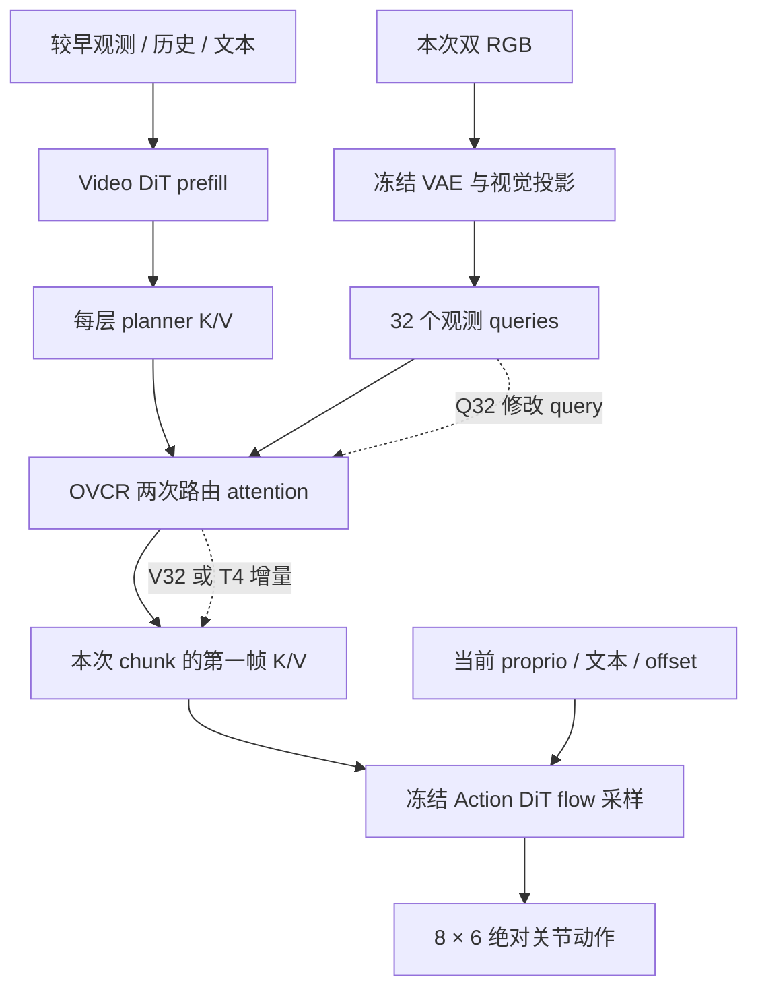

# 从本地代码到三种原生 OVCR adapter

## 1. 当前实际计算路径

核心源码是 [ahawam.py](../../src/ahawam/models/wan22/ahawam.py)、[ahawam_chunk_base.py](../../src/ahawam/models/wan22/ahawam_chunk_base.py)、[mot.py](../../src/ahawam/models/wan22/mot.py) 和 [action_dit.py](../../src/ahawam/models/wan22/action_dit.py)。以下描述针对本地版本，而非只根据论文架构图推测。

训练时 action horizon 是 40，分成 5 个长度 8 的 chunk；模型通用配置中的 64/16 不是这组 SO101 设置。SO101 的 `max_action_offset=7`、历史长度 6、视频帧步长由 action/video ratio=4 决定；使用原数据处理器与 stats。普通 `current_only` 推理消费 planner prefill 的当前帧 K/V，并不先完整去噪一段未来视频。生成视频的训练监督仍是表示来源，但不等于在线每块都显式生成未来视频。

关键调用点：

| 操作 | 本地方法 |
| --- | --- |
| 观测 latent 变成 query | `AHAWAMChunkBase._build_chunk_kv_queries` |
| 本次推理的 OVCR 条件 | `AHAWAM._prepare_inference_chunk_conditioning` |
| 多层在线 cache 改写 | `MoT.build_chunk_updated_video_kv_cache` |
| 普通／offset 训练 | `AHAWAM._training_loss_impl` / `_training_loss_action_offset` |
| 训练的 action/video 交互 | `MoT.forward_prior_action_with_chunk_updated_kv` |
| 另一种预填充路径 | `MoT.prefill_video_and_editor_cache` |
| 三条路径共用的注入点 | `LayerwiseChunkKVCacheEditor.build_layer_updated_cache` |

本轮把注入放在最后这个共享点，因此普通训练、offset 训练和在线 chunk 推理不需要各写一套不同的 adapter。

## 2. 原 OVCR 的张量和运算

省略 batch、chunk、head 下标，原每层 editor 可写为：

$$
U_l=W^q_l\operatorname{LN}(Q),\quad
R_l=\operatorname{softmax}(U_lK_l^T/\sqrt d)V_l,
$$

$$
W_l=\operatorname{softmax}(K_lR_l^T/\sqrt d),\quad
D_l=W_lR_l,
$$

$$
(\Delta K_l^0,\Delta V_l^0)=\operatorname{MLP}_l(D_l),\quad
\bar K_l=K_l+\sigma(b_l)\Delta K_l^0,\quad
\bar V_l=V_l+\sigma(b_l)\Delta V_l^0.
$$

`use_delta_gate=false` 时省略最后的 sigmoid。这个已有的 `delta_gate` 是原 editor 的参数，并不是新训练的人类干预预测器。

| 量 | 本地形状 |
| --- | --- |
| `chunk_queries` | `[B,N,32,4096]` |
| `first_frame_keys/values` | `[B,S,3072]`，24 heads × 128 |
| `routed` | `[B,N,32,24,128]`，新模块入口展平成最后一维 3072 |
| `decoded` | `[B,N,S,3072]` |
| 原／改写后 K/V | `[B,N,S,3072]` |

在当前 384×320 拼图、VAE 网格 24×20、Video DiT 2×2 patch 下，`S=120`。空间粒度随实际输入配置改变，代码读取真实 tensor shape，不硬编码 120。

注意原 editor 并不是一个很小的 MLP：30 层都有 4096→3072 query projection 和大 delta MLP。仅仅宣布“只训练 OVCR”仍可能有十亿量级训练参数。这里冻结整个原 editor，另外增加百万量级模块。

## 3. Q32：改路由 query

实现：`OVCRAdapter(mode="query")`，每层一个 `ZeroResidual(4096,4096,32)`。

$$
Q'_l=Q+\alpha\,W^{up}_l\operatorname{SiLU}(W^{down}_l\operatorname{LN}(Q)).
$$

之后原两次 attention、原 delta MLP 和 Action DiT 全部照常计算。每层 adapter 不共享参数，但同层跨 batch/chunk 共享。

**假设：** 当前观测已经能识别偏差，原 planner 保有可用内容，只是路由／对齐不够适合纠正分布。改 query 能让原模型重新读取其已有信息。这是基于本地计算图的推理，尚无本项目实验证明。

**优势：** 不新增 attention 序列位置；通过原 editor 的结构约束改写方式；表达较克制。

**可能失败：** 原 delta MLP 的 Jacobian 太小，或 query softmax 饱和，则 action loss 到 Q32 的梯度很弱。特别是一个全新、最后层全零的原 editor，在初始时刻对 query 的动作梯度可能为零。因此本方案从已训练的任务 P0 出发，不能冻结一个随机初始化的 editor 就期望 query adapter 学会任务。

## 4. V32：只给 editor 的 Value 增加纠正

实现：`OVCRAdapter(mode="value")`，每层 `ZeroResidual(3072,3072,32)`。

$$
K'_l=\bar K_l,\qquad
V'_l=\bar V_l+\alpha\,W^{up}_l\operatorname{SiLU}(W^{down}_l\operatorname{LN}(D_l)).
$$

这个增量接在原 gate 之后，不再乘原来可能很小的 `sigmoid(delta_gate)`。它是对 **当前观测已经路由过的内容** 做低容量纠正，输入不是无条件的常数。

**推荐首先试它。** 同一层中 Key 仍决定“寻址”，Value 是“取出什么内容”。只改 V 减少一个直接改变 attention logits 的自由度，便于判断性能增益是否来自内容修正。此解释是局部的：新 V 会影响后续层的 action query，并非全网络 attention 权重不变。

**可能失败：** 关键目标根本没有被路由到 `D_l`；这时在已丢失信息后处理 Value 无法恢复原始图像细节，应比较 Q32 或显式腕部 encoder，而不是无限增大 rank。

## 5. T4：少量 token 读取并写回 K/V

实现：`OVCRAdapter(mode="token_kv")`，每层一个 `TokenWriter`。这里的 token 是 **低维可写入的中间瓶颈**；与 RLT 原文冻结的只读状态有实质区别。

先投影当前 query 与 planner-conditioned routed query：

$$
X_l=[P^o_l\operatorname{LN}(Q);\;P^r_l\operatorname{LN}(R_l)]\in\mathbb R^{64\times r}.
$$

可学习 query bank `E_l` 读取 X，得到 m 个 token：

$$
Z_l=\operatorname{softmax}(E_lX_l^T/\sqrt r)X_l,
\quad Z_l\in\mathbb R^{m\times r}.
$$

再用已有空间槽的 decoded feature 为 query，把 token 解码回 S 个槽：

$$
H_l=\operatorname{softmax}(P^s_l\operatorname{LN}(D_l)Z_l^T/\sqrt r)Z_l,
$$

$$
(\Delta K_l,\Delta V_l)=W^{out}_lH_l,\quad
(K'_l,V'_l)=(\bar K_l,\bar V_l)+\alpha(\Delta K_l,\Delta V_l).
$$

默认 `m=4,r=32`。读取观测和路由内容的分工受 [Perceiver 的 latent attention](https://arxiv.org/abs/2103.03206) 启发；“是否适合插入纠正”仍是待检验假设。

**为什么不用简单 append 新 K/V token？** 即使新 token 的 V 为零，它们的 Key 仍进入 softmax 分母，可能在初始化就改变基础策略。写回原空间槽、增量输出全零能避免这个问题，也不用修改 video token mask、RoPE、history cache 长度和 chunk 索引。

**一个有用的消融细节：** 当 `m=1` 时写回 attention 在 token 维恒等于 1，每个空间槽收到同一 latent 的输出，难以做空间差异化写入；因此 m=1 是“全局调制”对照，不是与 m=4 完全同能力的省参数版本。默认不是把所有信息硬塞进一个窄 token。

T4 的潜在优势是把当前观测与 planner 内容结合成一个显式可研究的瓶颈；风险是它约有 V32 的 2.7 倍参数，K 的修改也更容易扰动寻址。若 T4 胜出，必须再用等参数版本确认不是单纯容量差异。

## 6. 三方案共同的初始化和冻结契约

所有 `up`／`output` projection 的 weight、bias 全零；down projection 正常随机初始化。这样初始 \(\Delta=0\)，但输出层仍能接到非零梯度。不能把 down 与 up 都置零，也不再叠一个初始为零的可训练乘法 gate，否则会造成梯度被双重零因子阻断。

`adapter.enabled=false` 或 `adapter.scale=0` 是显式 bypass。它能在同一输入／cache／noise 下恢复 P0；现实 rollout 的闭环轨迹已经分叉后，关闭 adapter 不会让机器人回到 P0 原本会访问的状态。

原始 VAE、text encoder、Video DiT、Action DiT、proprio encoder、视觉 projection、query encoder 和原 editor 全冻结；只训练 adapter。`MoT.training=True` 仅用于原 non-reentrant checkpointing，frozen experts 保持 eval。**冻结权重不阻断输入梯度**，Action DiT 和已注入 adapter 的 editor 不能整体包进 `no_grad()`。

增量用非原地加法构造；base planner cache 不被写脏。在线先为一个 chunk 构造 edited K/V，随后每个 action flow step 复用；不会每个 flow step重新运行 T4。

三方案都不向 Video DiT 反馈训练梯度或反向写入它的历史。因此“加在 Video 和 Action 之间”的准确意思是 **修改供 Action 消费的副本**，而非同时把两个 DiT 联合 RL。

## 7. 训练损失与 P0 保持

设 frozen base 参数为 θ₀，新 adapter 为 φ。用本仓库原 action scheduler 构造 noisy action 和 flow target，不手写另一套 t 的方向：

$$
\mathcal L_{BC}=\mathbb E\left[w(t)\,\operatorname{MaskedMean}_{valid}
\|v_{\theta_0,\phi}(x_t,t,c)-u^*\|^2\right].
$$

demo 和连续 HUMAN 均使用真实有效 action target；`action_is_pad` 排除跨段复制的尾部动作。来源采样由现有 loader 完成。Video loss 系数设为零且 Video 权重冻结。

再在 demo source=0 的样本加入同噪声 velocity anchor：

$$
\mathcal L_{anchor}=
\operatorname{MaskedMean}_{valid\land demo}
\|v_{\theta_0,\phi}(x_t,t,c)-\operatorname{sg}(v_{\theta_0}(x_t,t,c))\|^2,
\quad \mathcal L=\mathcal L_{BC}+\lambda_a\mathcal L_{anchor}.
$$

实现先在 `torch.random.fork_rng` 中关闭 adapter、无梯度运行 P0，捕获 flow；退出后恢复 RNG 再执行 student。这样无需在显存复制第二份大模型，同时两次拥有相同 noise、timestep、训练 offset 条件。额外 forward 仍要花时间，并不是免费 teacher。Native BC 用原 scheduler 权重；anchor 使用不额外乘 scheduler 权重的 masked velocity MSE，这个系数定义须在实验中保持一致。

anchor 的 teacher 是 **固定 θ₀**，要求所有非 adapter 参数被冻结；代码发现 base 可训练会报错。它只对 demo source=0 生效，不强迫 HUMAN 样本模仿失败的 P0。demo 不保证全是当前 P0 已会的状态，所以 BC 与 anchor 可能竞争；λa=0/0.1/1 是必要消融。

已有草案中“令 gate=0 再计算 anchor”需要修正：如果硬关闭 adapter，student 与 P0 完全一样，anchor 恒零，不能约束 adapter 在正常启用时的偏离。这里的 student 始终启用 adapter，只有 teacher bypass。

## 8. 本轮为什么没有立刻加 intervention gate

现有训练 dataset 只暴露 demo 和 HUMAN。`data_source=1` 表示这一行是谁控制，不等于“前一秒机器人是否应该请求接管”。直接拿它训练风险 gate 会带来选择偏差，也无法评估正常自主段的误报警。

本轮先比较常开且零初始化的小增量。未来 gate 必须单独使用完整 raw episode 的 takeover 预测标签、成功自主负样本、horizon 内无效／截断标签以及 episode 级 split。建议 gate 输入包括当前视觉、proprio、cache age、phase、执行队列；最终按 precision-recall 和 false positives/minute 标定。它不是本轮已经实现的功能。

## 9. 额外只读 RLT 原型

[RLTokenReadout](../../src/ahawam/models/wan22/rl_token_readout.py) 提供冻结特征的 encoder＋因果重建，支持 valid mask、右移后的 decoder padding mask、固定输入序列长度上限和位置编码。相对原 RLT，默认加入 4096→256 等可配置维度投影，是资源受限的变体。

它与 T4 没有隐藏绑定，不会暗中给 T4 加重建损失；两者一起训练属于另一项实验。最简单的输入是 query 序列，但它只是 observation-only readout。若希望 z 同时包含慢 planner 信息，必须明确定义某层 routed features 或 query＋routed 的导出器，记录层号、维度、cache 协议及版本，再分别评估。

已有 `train_readout.py` 可训练符合格式的冻结 feature 文件；本轮没有伪造在线 cache 或把旧 HUMAN 的单图重算结果标成真实 rollout latent。
