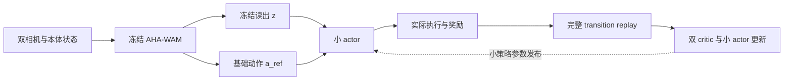

# AHA-WAM 的在线 RL 接口与梯度路径

## 1. 当前框架具备什么

AHA-WAM 已有任务 SFT、Video DiT 的观测/历史缓存、OVCR 的当前观测更新、Action DiT 的分块采样和服务端部署。这些足以作为一个冻结的基础策略，接入外部 off-policy learner。缺少的是奖励 transition、actor/critic、replay、target 更新、在线权重发布和实机评估闭环，不是再多一个 SFT loss。

原始需求是 SO101、全局 RGB 与腕部 RGB、6 维动作。现有 power-adapter 数据配置和当前 cylinder 部署配置都是 15 Hz、action horizon 40、chunk 8、10 步 action sampler；不同任务必须各自使用对应 checkpoint、stats、instruction 和数据，不能把 power-adapter demo 直接给 cylinder critic 当同任务经验。

既有四轮混合 SFT 是合理的监督基线，但最后一个 checkpoint 不自动最适合 RL。应选择固定评测集上表现稳定的任务模型；power-adapter 可从原 step_005328 与混合 SFT 中选择，cylinder 使用其任务模型。在线 RL 阶段冻结该选择，避免 replay 中的同一表征对应不断变化的基础生成器。

## 2. 代码中真正生效的路径

| 位置 | 已核对事实 | 对在线 RL 的含义 |
|---|---|---|
| [ahawam.py](../../../src/ahawam/models/wan22/ahawam.py)，`prefill_video` | 调用 `_prepare_action_start_latents(..., start_latents=None)` | 当前正式入口没有暴露外部连续噪声 |
| [base_wam.py](../../../src/ahawam/models/wan22/base_wam.py)，`_prepare_action_start_latents` | 已支持显式 `[B,H,action_dim]` latent；否则按 seed 生成 Gaussian | 底层能力可复用，但要打通分块 API |
| [ahawam_chunk_base.py](../../../src/ahawam/models/wan22/ahawam_chunk_base.py)，`infer_action_chunk` | 先准备当前图像/proprio 条件，再从 `start_latents[:, chunk_start:chunk_end]` 取噪声并积分 | 噪声控制应作用于当前 8×6=48 维块，不必一次控制 40×6=240 维 |
| 同文件，`infer_action` | video/action 两阶段，执行后递增 chunk index；推理入口处于 no-grad | 小外部 actor 可保持该路径；动作 Q 路径要另写可微采样接口 |
| [ahawam.py](../../../src/ahawam/models/wan22/ahawam.py)，`_should_update_action_history` | **返回 False** | 当前 AHA 不把基础动作写入 clean-action history KV |
| [ahawam_policy.py](../../../deploy/server/ahawam_policy.py)，`_infer_action_chunk` | 传图像、proprio、采样步数等，没有 noise/control latent 参数 | DSRL 需要加参数；输出 residual 可在结果后接入 |
| 同文件，normalization | state 走 processor；action 用对应 normalizer 反归一化 | z-score 不是 [-1,1]，不可直接搬来其他机器人 residual 幅度 |
| [ahawam.yaml](../../../configs/model/ahawam.yaml) | `action_conditioned: false` | 当前 video 预测不能直接充当候选动作的反事实 RL 环境 |

链接中列出的源码及函数名构成本地代码证据。部署配置只是磁盘快照，不据此推断正在运行的服务；当前 launcher 已支持选中配置中的 serving 字段，本报告不把部署错误作为既有失败的解释。

### 缓存问题的准确范围

父类确实含有“预测基础动作后，立即预填动作历史”的代码，但当前 AHA 子类关闭了它。因此，第一版输出 residual **不需要为了不存在的 action-history 写入重构整个模型**。

仍需处理的是 video/history cache、chunk index、时间位置、实际执行长度与观测时间。不能对同一 state 连续调用多次 `infer_action` 来试不同噪声而让 chunk index 悄悄推进；也不能在 replay 的一张孤立图像上随机重建历史，再称其为采集时同一个条件。

如果以后换成启用 action history 的类，才需要把生成与提交历史分开，提交真实执行的动作；这个条件性需求应保留测试，不能提前当成当前 bug。

## 3. OVCR 是否一定要反传 Action DiT

记 h 为完整推理条件，包含观测、历史/cache、chunk 位置等；G 是冻结 Action DiT 的完整采样器；w 是初始噪声；a 是真实关节动作块。

### 路线 A：更新 OVCR 参数，critic 评价动作

设内部 adapter 参数为 φ：

```text
a = G(h, w; OVCR_φ)
L_actor = -Q(h, a) + regularization
dL/dφ = -(dQ/da) (dG/dOVCR) (dOVCR/dφ) + ...
```

即使 G 的参数 `requires_grad=False`，对其输入求导仍需 Action DiT 中间激活和反向计算。若用完整 10 步采样的 pathwise gradient，一般要保留或重算多步的计算图；只训练几百万 adapter 参数主要省下可训练权重、梯度和 optimizer state，**没有消除大模型输入梯度的计算**。

当前 no-grad 推理 API 不能直接拿来做这种 actor 更新。把返回动作 `detach` 后再送入 Q，会导致 φ 收不到 actor 梯度；去掉冻结主干的 optimizer 也不会自动解决 no-grad。

### 路线 B：让小 actor 输出 OVCR 控制变量，critic 评价控制变量

先定义并冻结一个 writer W，再令小 actor 输出 u：

```text
u ~ π_φ(u | h)
KV_new = KV_base + W(h, u)
a = G(h, w; KV_new)
Q_u(h, u) 学真实回报
L_actor = E[α log π_φ(u|h) - Q_u(h,u)]
```

actor 梯度只穿过小 Q 和小 actor；G、W、机器人整体属于该 latent-action MDP 的转移过程。这与 DSRL 的噪声 MDP 思想相通，但 **任意 OVCR writer 并没有因此获得 DSRL 的实验证据**。[^1]

V32/Q32/T4 目前都是 h 到内部修正的监督模块，没有一个已经验证的、可供 RL 控制的 u 输入。直接把权重向量当作每步动作会造成巨大动作空间和持久状态改变，不是合理的快速迁移。

若新 writer 采用零初始化输出矩阵，初始阶段任意 u 都可能产生相同动作；latent Q 看不到可学的控制差异。应先用监督数据/扰动任务训练出可控、低维、冻结的 writer，并测有限差分动作变化及真实可执行范围，再考虑在线 RL。

### 路线 C：在初始噪声上做 DSRL-SAC

```text
w ~ π_φ(w | h)
a = G(h, w)          # no_grad，只在采集端
Q_w(h, w) → reward
```

这里 writer 就是已有生成器的噪声入口，不需要发明新的 OVCR 解码器。actor 更新依赖 Q_w 对 w 的导数，不依赖 G 的导数。只要 learner 使用采集时存下的冻结表征，就不必在 replay batch 中重跑 DiT。[^1]

噪声到动作的可控性仍然必须实测：有些任务模型对噪声变化不敏感，有些噪声主要改变抓取模式而不是毫米级对准。固定同一真实观测与缓存、离线抽取多组 w，比较动作的方向、幅度及可达纠正范围，是值得先做的诊断；动作多样性本身也不等于奖励改善。

### 路线 D：最终动作后接小 actor

```text
z = E(h)                          # 冻结表征
a_ref = G(h, w_base)               # 冻结基础动作
a = a_ref + bounded_residual(z, proprio, a_ref)
Q_a(z, proprio, a_ref, a) → reward
```

这是本项目第一优先路线。它不要求 critic 学懂任意 OVCR latent，也可以直接评价人工实际执行动作。其风险是 residual 可把动作推离基础策略常见区域，因此必须明确动作单位、幅度边界和执行后的真实结果。



图中的learner从replay读取冻结特征和reference；没有从Q回到AHA-WAM的梯度边。若改变为动作Q优化OVCR权重，这条大模型梯度边就会重新出现。

RLT 的原文 actor 是参考动作条件下的 Gaussian 动作块策略；严格的“基础动作加有界 residual”是另一个参数化选择，不能把二者当成完全同一算法。[^2]

## 4. 计算成本比较

令 F 为一次基础动作块生成的成本，B 为 replay batch，K 为 denoise 步数，U 为每批新交互后的更新次数。忽略小 MLP 后：

| 方法 | 采集端 | learner |
|---|---|---|
| 输出 residual / RLT 风格动作 actor | 基础模型 F + 小 actor | 小 actor/Q；若表征已冻结并缓存则无 F |
| DSRL-SAC | 基础模型 F + 噪声 actor | 小 actor/Q，无 F |
| DSRL-NA | 同上 | TD target 和噪声 Q 蒸馏都需 batch 基础模型前向 |
| OVCR 参数 + 动作 Q pathwise | 基础模型 F | batch 去噪前向 + 输入梯度反向 |
| OVCR latent + latent Q | 基础模型 F + writer | 小 actor/Q，但 writer 要先证明可控 |
| DPPO 类主干更新 | 去噪轨迹采集 | 去噪网络的梯度更新；不同于直接穿过整条采样链 |

DPPO 将去噪过程纳入策略优化，因此不能笼统地说“所有 diffusion RL 都必须对完整采样链做 pathwise 反传”；它仍不具备纯小 MLP learner 的计算优势。AHA 的 flow sampler 与 DPPO 的随机 diffusion likelihood 也不是改一个 loss 就完全兼容。[^3]

DSRL-NA 官方示例每轮 20 次 TD 更新、10 次噪声 Q 更新，B=256、基础 DDIM 8 步。若仅把采样步数换成 AHA 的 10，按代码结构估算会出现 (20+10)×256×10=76,800 次“单样本 Action DiT 前向”等价计算/训练轮。这是计算量计数，不是实测延迟；缓存重建与显存会进一步影响能否批处理。[^4]

## 5. 在线 RL 的适用边界

在线 RL 最适合“经常到达孔口，偶尔成功，有局部可改进动作”的情况。若主要失败来自拿不到物体、相机遮挡、动作单位错配、执行延迟或接触完全不可观测，先做局部阶段、时序与观测诊断会比增加 Q 更有价值。

双 RGB 与 proprio 可以先用；接触任务可能需要增加历史、位置跟踪误差或经标定的负载信息。不能将普通舵机读数未经校准当成力传感器，也不能把 video 想象中的插入画面当成真实 reward。

在线 RL 的新信息来自“执行某个动作后到底成功还是失败”，并非 critic 名字本身。只把 HUMAN action MSE 改成 Q 加权、却没有可靠的新 transition 和奖励，无法回答真实在线改进问题。

[^1]: Wagenmaker 等，[DSRL](https://arxiv.org/html/2506.15799v2)，2025；[官方代码](https://github.com/ajwagen/dsrl)。
[^2]: Xu 等，[RL Token](https://arxiv.org/html/2604.23073v2)，2026，§IV；[Policy Decorator](https://arxiv.org/html/2412.13630)，2024/ICLR 2025。
[^3]: Ren 等，[Diffusion Policy Policy Optimization](https://diffusion-ppo.github.io/)，ICLR 2025。
[^4]: [DSRL 固定版本配置](https://github.com/ajwagen/dsrl/blob/8d21b9cf55459f022c0e769bca1343edd9d30e5a/cfg/robomimic/dsrl_can.yaml)；[NA learner 固定版本](https://github.com/ajwagen/stable-baselines3-dsrl/blob/10e5d311b5c42fe571ff3eeb72f622ca616a149d/stable_baselines3/dsrl/dsrl.py)。

## 来源

本地源码位置见第 2 节；外部方法依据见脚注 1–4。完整版本与可复用范围见 [来源清单](SOURCES_ZH.md)。
