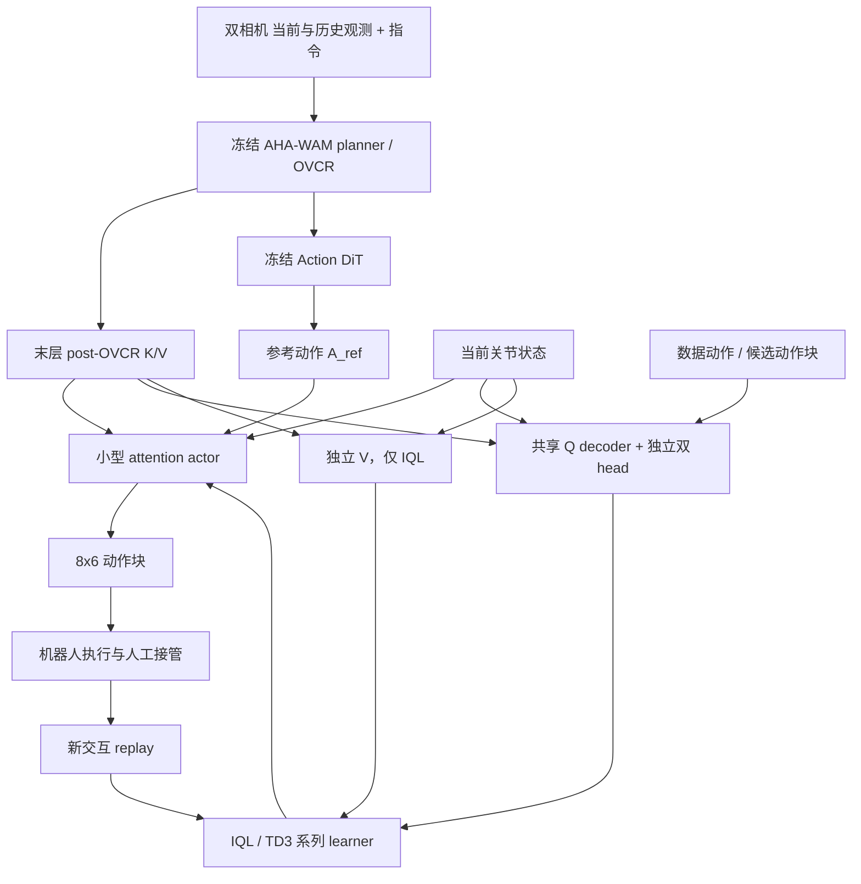

# AHA-WAM 精密插入：HG-DAgger 与离线—在线强化学习项目总结

整理日期：2026-10-26。适用方向：机器人学习、具身智能、强化学习、机器人基础模型后训练与真机系统研发。

**写作口径：本文是按项目计划全部完成后的口吻整理的简历草稿。** HG-DAgger、离线系统和部署部分依据现有实现；在线 replay、在线 learner 与真机在线改进部分按照既定路线补全。正文可作为目标完成态的表达素材，实际代码状态核对见最后一节。没有为尚无记录的 RL 成功率、交互效率或推理加速编造数字。

## 1. 项目定位

**推荐名称：基于世界—动作模型与人类干预的机器人精密操作及离线—在线强化学习**

短标题：**AHA-WAM 精密插入与人机协同强化学习**。

英文名称：**Human-Guided Offline-to-Online Reinforcement Learning for WAM-Based Precision Insertion**。

项目围绕低成本 SO-101 的圆柱插入任务展开，并以电源适配器插接等精密操作任务上的 HG-DAgger 实验作为交互式模仿学习基础。核心是把已经发生的机器人失败、人工纠正和成功经验继续用于价值学习，建立“示范 SFT → HG-DAgger baseline → 离线 RL 初始化 → 在线交互改进”的完整流程。

贡献集中在预训练 AHA-WAM 的真机适配、纠正数据闭环、planner KV 上的小型 actor–critic、离线/在线算法适配和可复现实验系统。AHA-WAM 骨干及 IQL、TD3 本身来自已有工作；本项目实现了它们在该平台与数据语义下的结合。

## 2. 可直接放进中文简历的版本

**AHA-WAM 精密插入与人机协同强化学习｜机器人学习项目**

`Python` · `PyTorch` · `AHA-WAM` · `World–Action Model` · `HG-DAgger` · `IQL` · `TD3+BC` · `Offline-to-Online RL` · `Cross-Attention` · `Flow Matching` · `LeRobot` · `DeepSpeed`

- 面向 SO-101 精密插入任务，搭建双相机视觉、关节状态、远程推理与人工接管一体化系统，完成预训练 AHA-WAM 的任务适配和 HG-DAgger baseline，形成策略 rollout、人工纠正、数据聚合、后训练与真机评测闭环。
- 设计 RLT-inspired 轻量强化学习架构：冻结 WAM，以 planner 最后一层经 OVCR 更新后的 K/V 作为分布式状态表征，由约 **386 万参数**的 attention actor 联合读取关节状态和参考动作，直接输出 **8×6 动作块**；配套共享主干双 Q 与独立 V，将大模型表征推理和小网络 RL 更新解耦。
- 基于 **103 条 HG-DAgger episode** 构建稀疏奖励离线 RL 数据集，保留 POLICY/HUMAN 实际动作，处理暂停连续性、HOLD 等待、成功帧归因及提前截断；构建 **18,872 个训练转移与 858 个验证转移**，按 episode 隔离并留出成功、失败样本，分别实施 chunk-IQL 与 TD3+BC 策略改进。
- 实现离线初始化到真机在线学习的持续改进流程，融合历史纠正数据与新增交互 replay，采用小 actor–critic 更新、延迟策略更新、版本化参数同步及人工接管恢复，支持 IQL 持续更新和 TD3 系列在线优化两条路线。
- 构建四卡 BF16 特征缓存、多实验训练调度、断点恢复、模型/数据版本校验和逐帧价值诊断工具；通过双视角视频、IQL V、双 Q、TD 误差和动作偏离分析支撑策略比较，并复用统一部署接口对比 SFT、HG-DAgger 与 RL 策略。

### 简历空间较少时的三条版

- 搭建 SO-101 双相机精密插入与 HG-DAgger 真机闭环，统一策略执行、人工接管、纠正数据聚合和后训练，建立 SFT/HG-DAgger 对照基线。
- 设计冻结 AHA-WAM 的 RLT-inspired actor–critic，以末层 post-OVCR planner KV、关节状态及参考动作为输入，通过约 386 万参数的小 actor 输出 8-step 动作块，结合双 Q 与 V 实施 IQL、TD3+BC 离线学习及在线策略改进。
- 基于 103 条真机 episode 完成连续动作块、稀疏成功奖励及截断自举建模，构建四卡特征缓存、离线—在线 replay、部署与价值可视化系统，实现基础模型表征复用与轻量 RL 更新。

### 若希望加入已有的实测结果

可在 HG-DAgger 那条后面补充：

> 在已有真机实验中，Segment-only 人类纠正基线将圆柱任务完成率从 1/13 提升至 4/13，将电源适配器任务从 10/20 提升至 15/20；进一步比较跨接管历史和未来视频监督对纠正学习的影响。

这些是已记录的**模仿学习阶段**结果，不应作为 IQL、TD3 或在线 RL 的结果。若篇幅有限，可直接保留前面的系统与算法数字，不强行加入这组小样本成功率。

## 3. 面试介绍：约一分钟版本

> 这个项目是用 AHA-WAM 在 SO-101 上完成圆柱插入等精密操作。我先建立了 SFT 和 HG-DAgger baseline，让模型在实际 rollout 中遇到偏差，再由人接管纠正，并把纠正数据用于后训练。
>
> 后续我希望进一步利用已有数据中的成功、失败和恢复经验，所以设计了一个 RLT-inspired 的轻量 RL 架构：冻结大模型，直接读取 planner 末层经过 OVCR 更新后的 KV，用小型 attention actor 结合关节状态和原策略参考动作生成动作块，再训练双 Q 和独立 V。离线阶段分别采用 IQL 和 TD3+BC，在线阶段继续用新交互和历史数据更新小网络。
>
> 这里比较关键的工作是把真机日志正确变成 RL 数据：暂停不拆 episode，HOLD 动作和主动控制分开，成功标注归因给产生该画面的上一条动作，没有录到成功的片段保留自举而不误标为失败。同时我把重型 WAM 推理提前做成缓存，RL 训练只更新小网络，并用逐帧价值视频和独立真机评测检查 critic 与策略表现。

## 4. HG-DAgger baseline：做了什么

### 真机与模型适配

完成 SO-101 与 AHA-WAM 的输入输出映射，输入包含固定相机、腕部相机、语言指令、关节状态及历史视觉条件，输出为 6 维绝对关节控制目标。这里的“6 维”指关节/夹爪控制向量，不是末端笛卡尔位姿。

AHA-WAM 由 Video DiT planner、OVCR 观测条件路由和 Action DiT 组成。普通动作推理通过历史与当前观测建立 planner KV，再由动作分支生成动作；项目使用的是其内部表征，不是额外生成一段未来视频后在视频中搜索动作。

采用 40-step 规划布局、8-step 执行动作块和 15 Hz 控制协议，区分控制频率、动作块覆盖时间及模型推理延迟。8 个动作覆盖约 0.533 秒，不能仅据此把远程模型称为无等待的 15 Hz 视觉闭环。

### 交互采集与纠正训练

实现 `POLICY / HUMAN / SYSTEM_HOLD` 控制状态，分别记录模型实际执行动作、人工实际执行动作和等待新决策时保持的目标。维护 request/chunk ID、接管事件、时间戳、动作裁剪和 stale reply/旧动作队列失效记录，支持多次接管与交还。

基于人工纠正片段构建 HG-DAgger 训练视图，与原始 demonstration 混合回放；区分短纠正的动作监督和具有足够时间上下文的联合视频/动作监督，避免把自主失败动作或系统等待直接当作专家标签。比较 Segment-only、跨接管历史和未来视频目标延伸等设置，分析纠正学习与 WAM 时序表征之间的关系。

模仿学习阶段与 RL 阶段的数据使用方式不同：HG-DAgger 主要把 HUMAN 纠正作为专家监督；离线 RL 同时利用 POLICY 和 HUMAN 已执行行为，通过奖励与价值目标进行策略改进。

## 5. 核心 RL 架构：小 actor 如何读取 planner KV

### 状态表征和参考动作

冻结采集数据时使用的 SFT AHA-WAM，包括 planner、OVCR 与用于产生 reference 的原 Action DiT。对每个观察提取：

| 输入/缓存项 | 形状 | 作用 |
|---|---|---|
| 最后一层 post-OVCR K | `120×3072` | 当前观测条件化后的 planner key |
| 最后一层 post-OVCR V | `120×3072` | planner value；保留分布式 token 结构 |
| 当前状态 | `6` | 原处理器归一化后的关节状态 |
| reference action | `8×6` | 冻结 Action DiT 生成的参考动作块 |
| routed / projected query | 各 `32×3072` | 路由分析和后续表征消融，不是主 actor 的额外必需输入 |

KV 已通过 planner 吸收历史，并由 OVCR 根据当前观测调整；小 actor 不需要重新输入所有历史图像，也不要求每个内部网络层保持 3072 维宽度。

### Actor

1. 对原始 K 和 V 分别做 LayerNorm 与 `3072→256` 投影。
2. 用当前关节状态和 8 个参考动作构造 9 个有序 query token，保留动作时序位置。
3. 通过 2 层 decoder，每层包含 self-attention、对 planner KV 的 cross-attention 和 4 倍宽度 FFN；hidden size 为 256，4 个 attention head。
4. 从 8 个动作 token 输出每步 6 维修正，形成：

   `A = clip(A_ref + ΔA, -5, 5)`。

5. 修正头末层零初始化，使初始 actor 在无 reference dropout 时等于基础参考策略；训练时以 10% 概率置零整块 reference，减轻对参考动作的完全依赖。

这里的残差发生在归一化动作空间，最后统一反归一化为绝对目标；机器人执行端不会再叠加一次参考动作。约 386 万参数是外部 actor 本体参数量，不包含冻结 WAM。

### 双 Q 与 V

Q 输入为 planner KV、状态和**待评价的动作块**。动作可以是数据中的实际动作，也可以是 TD3 actor 产生的候选动作。Q 不把 reference 当作额外条件，也不输入未来成功标签或控制来源标签。

Q 采用与 actor 同类的 attention decoder，保留动作顺序，将 9 个 token 展平后送入两个独立 MLP head。默认双 Q 共享注意力主干、分开输出，参数约 504 万；同时保留两个 Q 完全独立的消融配置。双 Q 的 minimum 用于相应算法目标，不把两个 head 的一致性等同于可靠不确定性估计。

IQL 另配独立 V，只读 KV 与状态，不读动作，参数约 386 万。Actor、Q、V 之间不共享可训练主干，因此各自投影可适配对应目标，损失不会通过共享参数相互改写。



## 6. 为什么叫 RLT-inspired，而不是直接复现 RLT

借鉴 RLT 的分工：复用大策略表征与参考动作，让小 actor–critic 通过真机奖励更新。但本项目直接读取 AHA-WAM planner 最后一层经过 OVCR 的分布式 KV，并由小 decoder 学习如何读取，不额外先训练一个单 token 的 RL readout，也不把状态 mean-pooling 后直接接 MLP。

结构上同时参考了 state/reference action token、self/cross-attention 与 MLP 输出的 latent-adapter 思路。准确表述为：

> 设计了面向 AHA-WAM planner KV 的 RLT-inspired、reference-conditioned chunk actor–critic。

参数高效体现在**可训练 RL 模块小、learner 不需反传大模型**。因为仍需在线计算 KV 和参考动作，不能把它描述为“推理完全不需要 WAM”或声称整个系统已经按参数比例获得同等推理加速。

## 7. 把 HG-DAgger 数据变成 RL 转移

### 数据规模与划分

本轮圆柱原始数据包含 103 个 episode、43,680 个保存观察。指定 4 条只用前半段后，缓存保留 42,862 个观察；建立 19,730 个自然动作块转移，其中训练 18,872、验证 858。

训练为 98 个 episode：78 个有成功帧标注的成功录像、9 个成功未录到的片段、11 个失败录像。验证为 3 个有成功标注 episode 和 2 个失败 episode，按完整 episode 隔离，不把相邻滑窗随机拆到两边。

两条失败验证轨迹为 `20260911_183057/episode_000000` 和 `20260911_225809/episode_000001`。四条前半段来自 `232927/ep7、ep15` 与 `001855/ep2、ep9`；完整名单、精确截止帧及源文件 hash 保存在版本化 recipe 中。

### 时间和动作块

- 以 episode 保存帧序列为连续时间轴。接管前后的暂停未保存成视频帧，因此 tick 跳号不代表任务结束，也不清空历史。
- 保留 POLICY 和 HUMAN 实际下发的动作，只跳过 SYSTEM_HOLD 的动作；HOLD 图像仍可用于 history 和后继观察。
- 从当前有效命令向后取自然 8 个动作。后继观察是第 8 个动作所在原始行之后的第一张保存画面，可以是 HOLD 第一帧。
- 在有效命令序列上 stride=1；不足完整 8 个动作的尾窗不补造标签，不跨 episode 或人为截断边界。
- 折扣按保留动作计数，`gamma=0.997`，普通动作块折扣约为 `0.997^8=0.97625`。原始墙钟耗时仍记录在 metadata，但不进入本轮折扣。

### 成功、失败和截断

人工标注的成功帧表示当前画面首次达到成功，因此正奖励归因给产生该画面的上一条动作。若成功落在一段 HOLD 中，按既定规则映射到该 HOLD 的第一张画面，避免把系统等待误当成新的成功行为。

动作块可自然跨过成功画面；若第 j 个动作取得成功，块奖励为 `gamma^j`，bootstrap discount 为 0。Q 与 actor 输入仍使用该窗口完整的自然 8 动作，不用成功后补零/复制的虚构尾部。成功之后不另起新的训练样本。

明确失败的录像末端按本轮有限 episode 任务设为终止。没有录到成功的 9 条录像则按 censored partial trajectory 处理：观察奖励为 0、`terminated=False`、保留 `gamma^8` 自举。对其中四条只取前半段，用于检验不完整经验的利用；不因为录像停止而把它们变成失败，也不在最后一帧补 +1。

这些设计把“未观察到奖励”和“未来回报确定为零”区分开，也把一次成功事件和多个重叠正奖励窗口区分开。

## 8. 离线 IQL：critic 与 actor 如何更新

记 `x=(K,V,s)`，数据动作块为 A，块奖励为 R，构造器给出的 bootstrap discount 为 d。

**V 更新。** 用 target 双 Q minimum 做 expectile regression：

```text
q_data = min(Q1_target(x, A), Q2_target(x, A))
L_V = E[expectile_0.7(q_data - V(x))]
```

**Q 更新。** V 更新后计算：

```text
y = R + d * V(x_next)
L_Q = E[(Q1(x, A)-y)^2 + (Q2(x, A)-y)^2]
```

**Actor 更新。** 根据数据动作的优势加权 BC：

```text
advantage = min(Q1_target(x, A), Q2_target(x, A)) - V(x)
w = stop_gradient(min(exp(3 * advantage), 20))
L_actor = E[w * MSE(actor(x, A_ref), A)]
```

每个 minibatch 各更新一次 V、Q、actor，再做 target Q 的 EMA。优势权重 detach，不通过 Q 对 actor 动作求导。这有利于利用固定 HG-DAgger 数据进行策略提取，避免在离线备份中反复最大化数据外动作的 Q。

记录权重均值/上限、有效样本量 ESS、Bellman 误差和训练/验证差异，判断优势权重是否过度集中，或是否几乎退化为普通 BC。

## 9. 离线 TD3+BC：显式的价值驱动策略改进

使用同样的 KV、状态、reference 和动作块，使算法比较共享表征与数据契约。

```text
A_next = clip(actor_target(x_next, A_ref_next)
              + clipped_target_noise, -5, 5)
y = R + d * min(Q1_target(x_next, A_next),
                Q2_target(x_next, A_next))
L_Q = E[(Q1(x, A)-y)^2 + (Q2(x, A)-y)^2]

lambda = 0.1 / max(mean(abs(Q1(x, actor(x, A_ref)))), 1e-3)
L_actor = MSE(actor(x, A_ref), A)
          - lambda * mean(Q1(x, actor(x, A_ref)))
```

lambda 的 Q 尺度项 detach。BC 项约束 actor 不轻易离开实际执行行为，Q 项通过小 actor 的动作输出反传，学习有利于回报的修正。与 IQL 不同，这条路线会在更新中评价 actor 生成的动作，因此需要重点分析价值外推误差。

每步更新双 Q，每两步更新一次 actor、target actor 和 target Q；EMA 系数 0.005。Target smoothing 的归一化噪声标准差为 0.1、截断为 0.2。TD3+BC 不使用 IQL 的 V，也不从 IQL 的 optimizer 状态接续。

两项离线实验统一 batch 64、学习率 1e-4、10,000 更新、前 200 步 actor-only BC warm-start。这个 warm-start 不等于 Q/V 预热。

## 10. 在线 RL：目标完成态下的系统与更新

本节按计划完成后的口吻展开在线部分，补充的是与当前外部 actor–critic 架构一致的实施方案。

### 采集与学习解耦

搭建机器人执行/采集进程与独立 learner：采集端读取固定版本 actor 产生动作并记录结果，learner 从历史数据与新增交互 replay 中采样更新，再向执行端发布经过版本标识的参数。区分“采集与学习并行”和“WAM planner 本身的异步推理”，两者不是同一个机制。

Replay 除实际执行动作、奖励、后继观察外，保存冻结 WAM 条件、reference、原始观测/历史帧索引、模型与 actor 版本、动作实际执行范围、接管事件和时间戳。冻结表示保证历史 latent 不因 learner 更新而变化；保留原始索引以支持重算及条件一致性核对。

将服务端实际使用的历史与当前观测同记录端关联，维护显式 episode/观察时钟和 cache generation，核对 planner anchor、offset 及实际执行动作。未经执行的 proposal、被接管取消的动作尾部和 stale reply 不进入真实执行标签。

### 两条持续改进路线

**IQL 路线：** 从离线 IQL 初始化继续训练 Q/V/actor，使用新增交互与旧数据混合采样，保留 expectile value 与优势加权动作监督。每轮仍为 V、Q、actor 各一次，不因进入在线阶段就自动改成 TD3 的 loss。

**TD3 路线：** 从离线 TD3+BC 初始化，在新交互 replay 上继续进行 target-policy smoothing、双 Q backup 和延迟 actor 更新。保留行为约束作为早期稳定项，并把其强度作为在线配置，比较固定约束与随自主数据增加逐步调整的设置。

IQL 与 TD3 是两项分别初始化、分别评测的策略路线；只有单独定义并记录算法切换时，才把 IQL→TD3 当作第三种实验。

### 数据复用、更新频率与探索

采用历史离线数据和新增 replay 分池管理，起始按 1:1 混采，单独记录 HUMAN/POLICY、成功/失败和旧/新样本比例。该比例是工程起点，不作为已经证明最优的结论。

TD3 在线起始配置按每个新增、非重叠的完整 8 动作转移预算 2 次 critic 更新和 1 次 actor 更新；IQL 按同一新增数据预算安排等量 Q/V/actor 更新。日志分别记录新有效命令数、非重叠转移数、滑窗 replay 条数及各 optimizer step，避免把滑窗增广误当作真实交互量。

探索在归一化动作空间设置小幅噪声，并经绝对目标反归一化、关节范围/单步变化约束后执行。保留人工接管、停止和恢复能力，人工纠正作为真实执行经验进入 replay。自主成功率评测关闭人工帮助，接管率、辅助成功和完全自主成功分别统计。

### 部分执行、HOLD 与时序

执行端区分动作生成、接受、执行和取消，依据实际执行序列构建完整动作块，缺少完整动作/结果的尾窗不伪造。推理 HOLD 是系统等待状态，其图像和耗时保留，动作按同一主动命令压缩契约处理；episode 不因暂停或控制权切换被拆开。

保持冻结表示与训练时的 history/offset 规则，并记录部署侧无法完整匹配的时钟或观测年龄情况。模型服务的推理等待仍是系统时延的一部分，不把小 actor 的学习速度当作整机视觉控制速度。

## 11. 特征缓存、训练与部署工程

### 一次重型推理，多次轻量训练

将冻结 planner、OVCR 和 reference Action DiT 的推理提前导出，离线 learner 只读缓存更新小 actor、Q、V。使用 4 张 A100 40 GB 各加载一个 BF16 WAM 副本，按 episode 分工；128 个观察一个 safetensors 分片，索引与张量原子发布，逐片校验 SHA256。

本轮缓存为 **42,862 个观察、391 个分片、80,066,062,744 bytes，约 74.6 GiB**。K/V、routed/query 为 BF16，state/reference 为 FP32。使用按行 mmap 与有界 LRU，不把全部缓存一次性搬到 GPU；transition 只存轻量动作、奖励及当前/后继 key，避免重复存储大 KV。

每份缓存记录基座 checkpoint、归一化统计、原始视频/parquet、源码、history/offset 协议和帧范围的版本。每份训练 checkpoint 保存模型、target、optimizer、RNG、数据划分及 provenance，防止新旧 cache 或不同截断配置混用。

### 资源与验证

外部 actor 约 3.86M、共享双 Q 约 5.04M、V 约 3.86M 参数。Batch 64 时，已有实测 IQL/TD3 learner 的 PyTorch allocated 峰值分别约 1,244/1,201 MiB；这不包括冻结模型在线生成特征/reference 时的显存。

构建四卡导出→完整性检查→真实 cache 更新测试→两项训练的后台队列，自动记录每阶段 PID、命令、状态、耗时、显存和错误。完成 42 项 CPU 测试及新缓存上的真实 GPU actor/critic 更新检查，覆盖奖励归因、暂停连续性、截断自举、显式划分、梯度、归一化和恢复等关键契约。

### 复用既有部署接口

复用 `online_deploy` action server 与 YAML 配置，分别加载 IQL 外部 actor、TD3+BC 外部 actor，以及可选的 IQL 加权 Action DiT。外部推理服务只加载 actor，不构建 Q/V/优化器；Q/V 在训练时改善 actor，不等于每次执行都在线用 Q 选择动作。

输出继续采用 `8×6` 绝对关节目标，复用原相机处理、状态归一化和机器人端坐标转换。使用录制观察进行真实 TCP 服务回放、完整历史覆盖、reset 重现性和缓存/服务输出对齐测试，将服务计算正确性与真机闭环成功率分开验证。

## 12. 价值函数诊断与评测

构建 fixed/wrist 拼接视频，在每帧叠加 IQL V、IQL Q1/Q2、TD3 Q1/Q2 和近期滚动曲线。V 对状态表征评分，Q 对该状态下数据中的自然动作块评分；HOLD 或不完整动作窗不展示虚构 Q。

理论单次成功折扣回报的参考范围为 0–1，但网络输出不等于经过校准的成功概率，也不强行裁剪。未录到成功的片段不绘制“确定为零”的完整回报；混合人机数据的记录回报也不等于无接管 actor 的真实 Q。

联合分析：训练/验证 Bellman 误差、终止奖励拟合、Q 分歧、预测越界、IQL 权重 ESS、actor 对数据/参考动作的偏离，以及失败与提前截断片段上的时序趋势。最终以匹配初始化的真机试验比较 SFT、HG-DAgger、离线 IQL/TD3 和各自在线更新策略，分别统计自主完成率、完成耗时、接管次数及真实交互预算。

## 13. 可选扩展：IQL 优势加权微调原生 Action DiT

除外部 actor 主线外，实现了原生动作分支的价值加权后训练对照：固定 IQL Q/V，用真实动作的 detached 优势权重加权原有 flow-matching loss，在冻结主体上以 rank-16 LoRA 更新 Action DiT attention 投影。

该扩展不让 Q 梯度穿过 10 步采样器，而是通过权重改变真实动作训练样本的贡献。它与外部 deterministic actor 不同，也不等于原 IQL 的显式策略 log-likelihood 目标或 VINE 式完整生成路径价值反传。

由于原生 Action DiT 每层都要读取相应 planner KV，单独缓存末层不足以训练它；采用相同历史/offset 协议重算全部层条件，并验证末层 KV 与缓存一致。主线简历篇幅有限时，可不写这一扩展，集中讲清小 actor 与双算法离线—在线路线。

## 14. 已有结果与待填写的 RL 结果

已记录的模仿学习结果来自用户确认的汇总记录：

| 模型 | 圆柱插入 | 电源适配器插接 |
|---|---:|---:|
| SFT | 1/13，7.7% | 10/20，50.0% |
| Segment-only 人类纠正 | 4/13，30.8% | 15/20，75.0% |
| History | 5/13，38.5% | 13/20，65.0% |
| History+Future | 6/13，46.2% | 11/20，55.0% |

来源：[任务汇总记录](../icra2027_handoff/analysis/task_success_results.json)。该文件注明来源是用户确认的聚合结果，不是重建出的逐 trial 日志。不同设置的效果存在任务依赖性，不将“视频预测改善”写成“操作成功率必然改善”。

RL 结果可在完成相应真机评测后加入下列句式：

> 在相同初始化与评测预算下，离线 IQL / TD3+BC 将自主插入完成率由 HG-DAgger 的 `[a/N]` 提升至 `[b/N]` / `[c/N]`；经过 `[M]` 个真实在线决策更新后达到 `[d/N]`，并将人工接管率降低至 `[r]`。

这里需要填写实际 trial 数、独立运行/随机种子、在线交互定义及对应 checkpoint；不能用缓存观察数或 optimizer step 代替真实交互量。

## 15. 面试中最值得展开的技术判断

**为什么先建立 HG-DAgger？** 它提供纠正数据和可比 baseline，也让后续 RL 有相对合理的初始行为；而只有专家动作监督无法充分利用失败与延迟成功奖励。

**为什么冻结大模型？** 让既有表示保持稳定，复用固定缓存和 replay，把昂贵的模型推理与高频小网络梯度更新分开，降低每次 RL 实验成本。

**为什么直接用 KV？** KV 同时包含 planner 的历史上下文和 OVCR 的当前观测适配；保留 token 结构后由小网络学习读取，不先强制压成一个可能丢失精密空间信息的向量。

**为什么 actor 不会和 Action DiT 一样大？** 3072 维只存在于输入投影，decoder 内部为 256 维、2 层；外部 actor 一次前向输出动作，不做扩散/flow 多步去噪。但 reference 仍由冻结 Action DiT 生成。

**为什么两个算法都做？** IQL 用数据内动作学习价值并做优势加权策略提取；TD3+BC 显式通过 Q 优化生成动作，同时用 BC 约束外推。相同架构和数据使二者差异更容易解释。

**没有成功标签为什么不直接标成失败？** 因为录像截断只表示未来未观察到，不表示任务进入零回报吸收状态。保留 bootstrap 才不把半插入状态强行压成失败价值，但其尾部价值也依赖函数逼近，不能当作监督真值。

**训练 Q 时当前状态来自数据，是否就完全没有 OOD 问题？** 否。状态与候选动作的联合分布仍可能离开数据；TD3 会评价 actor 产生的新动作，在线新状态也可能未覆盖。双 Q、BC 与验证诊断能缓解和发现问题，不能保证任意新状态下评分可靠。

**怎么区分奖励建模和真实提升？** 价值拟合、服务回放和真机评测分别回答不同问题；自主成功率必须在关闭人工帮助的试验中统计，不把接管后成功当作新 actor 自主完成。

## 16. 工程入口与实际状态核对

| 模块 | 仓库位置 |
|---|---|
| HG-DAgger 数据与训练 | `scripts/so101_pipeline/hil_human_only_dataset.py`、`hil_human_only_training/` |
| RL episode recipe 与截断准备 | `scripts/so101_pipeline/offline_rl/prepare_rebuild.py` |
| 动作块、成功奖励与连续时间轴 | `src/ahawam/offline_rl/data.py`、`timeline.py` |
| 冻结 WAM 缓存与读取 | `src/ahawam/offline_rl/cache.py` |
| 小 actor、双 Q、V | `src/ahawam/offline_rl/networks.py` |
| IQL / TD3+BC 更新 | `src/ahawam/offline_rl/learner.py` |
| 四卡缓存与两项训练队列 | `scripts/so101_pipeline/offline_rl/rebuild_pipeline.py` |
| 价值视频与曲线 | `scripts/so101_pipeline/offline_rl/value_videos.py`、`value_video_render.py` |
| 外部 actor 服务 | `deploy/server/offline_rl_policy.py`、`scripts/so101_pipeline/online_deploy/` |
| 原生动作分支加权 flow / LoRA | `src/ahawam/offline_rl/flow_actor.py`、`scripts/so101_pipeline/offline_rl/action_dit.py` |
| 数据异常及用户确认规则 | [数据异常记录](../offline_rl/19_DATA_ANOMALIES_ZH.md) |
| 最新 episode 配置 | [归档 recipe](../offline_rl/episode_recipe_20261026.json) |
| 最新实验细则 | [重建与训练说明](../offline_rl/18_REBUILD_AND_EPISODE_RECIPE_ZH.md) |

**本次整理时读取的实际状态：** HG-DAgger 与旧离线 IQL、TD3+BC、加权 Action DiT 实验已有实现/运行记录；新连续 episode 与特殊样本 recipe 的全量 cache 已完成校验，IQL 和 TD3+BC 正在重训，读取日志时各到 300 step。本文第 10 节在线采集—replay—learner—参数发布及相应真机 RL 评测，是按用户要求写成完成态的计划内容，并非当前仓库已经完成的代码事实。

本文不改变后台训练、原始数据、论文结果或现有部署配置。用于正式投递的版本可直接从第 2 节裁剪，并在对应实验完成后填入第 14 节的实测结果。
